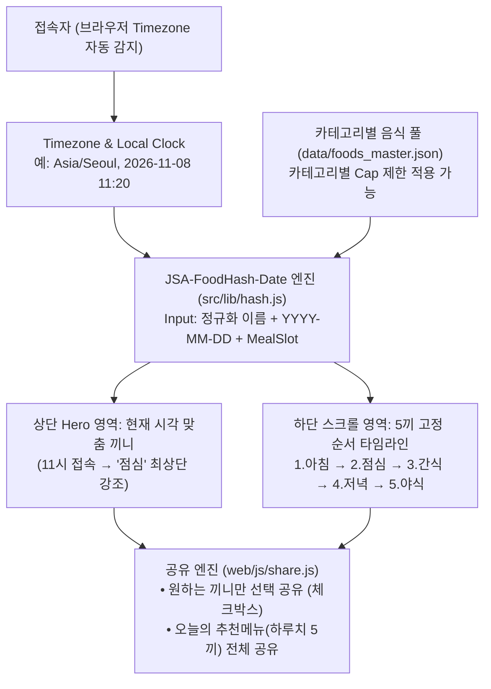

# 🍽️ 오늘 뭐 먹지? (Mukbang) — 이름 × 날짜 × 타임존 기반 하루 5끼 음식 추천 종합 기획서

- **서비스명**: 오늘 뭐 먹지? (`Mukbang` — 이름 & 날짜 기반 하루 5끼 맞춤 미식·급식·미슐랭·자연식 추천소)
- **서비스 도메인**: `https://food.tellmyname.app`
- **GitHub 저장소**: [`https://github.com/bsj805/food`](https://github.com/bsj805/food)
- **자매 프로젝트 참조**: `C:\Users\USER\Documents\projects\myhome` (`JSA-Hash` 아발란체 해시 엔진, Edge SSR, R2/로컬 이미지 서빙, Gemini 웹 자동 이미지 생성기 계승)
- **인프라 스택**: Cloudflare Workers & Static Assets (`food.tellmyname.app`) + 로컬 `images/` 및 R2 하이브리드 서빙 + Gemini 이미지 자동 생성기(`Gemini_foods_이미지자동생성.bat`)

---

## 1. 핵심 기획 배경 및 서비스 목표

1. **이름 + 날짜(`YYYY-MM-DD`) 결정론적 해시 매핑 (하루 동안 동일, 자정마다 리셋)**
   - `myhome`에서 검증된 한글 자모·획수 아발란체 하이브리드 해시(`JSA-Hash`)를 계승하되, **접속한 나라의 타임존 기준 오늘 날짜(`YYYY-MM-DD`)**와 **끼니 슬롯(`breakfast`, `lunch`, `snack`, `dinner`, `night`)**을 해시 시드에 결합한다.
   - **하루 동안의 일관성**: 같은 날(`2026-11-08`) 같은 이름(`김서윤`)을 입력하면 언제 조회하든 하루 종일 100% 동일한 아침·점심·간식·저녁·야식 메뉴가 추천된다.
   - **매일 바뀌는 리텐션(Daily Retention)**: 날짜가 `2026-11-09`로 바뀌는 순간 아발란체(Avalanche) 효과로 5끼 메뉴가 완전히 새롭게 추천되어, 사람들이 **"오늘은 나한테 무슨 음식을 추천해줄까?"** 궁금해서 매일 들어오게 만든다.

2. **타임존(Timezone) 기반 '지금 먹을 끼니' 최상단 노출 + 하단 5끼 정배열 스크롤**
   - 접속자의 브라우저 타임존(`Intl.DateTimeFormat().resolvedOptions().timeZone`)과 현지 시각(Local Hour `0~23시`)을 자동 감지한다.
   - **상단 히어로(Top Hero Spotlight)**: 현재 시각에 해당하는 끼니를 페이지 최상단에 가장 크게 보여준다.
     - 예: 오전 **11시**에 접속하면 **☀️ 점심 추천**이 제일 상단에 노출됨!
     - `05:00 ~ 09:59`: 🌅 **아침 (Breakfast)**
     - `10:00 ~ 13:59`: ☀️ **점심 (Lunch)**
     - `14:00 ~ 16:59`: 🍰 **간식/디저트 (Snack & Dessert)**
     - `17:00 ~ 20:59`: 🌙 **저녁 (Dinner)**
     - `21:00 ~ 04:59`: 🦉 **야식 (Late-night Snack)**
   - **하단 전체 타임라인 스크롤**: 상단 추천 카드 아래로 스크롤하면 현재 시간과 관계없이 항상 **아침 → 점심 → 간식(디저트) → 저녁 → 야식** 순서대로 하루 5끼 전체 코스가 정렬되어 보인다.

3. **스펙트럼 극대화: 생당근·급식 메뉴부터 미슐랭 3스타·음식점 특이 메뉴까지 총망라**
   - 평범한 메뉴만 나오는 지루함을 없애기 위해 **1단계(원시 수집)**에서 종류에 상관없이 모든 음식을 모은 뒤, **2단계(카테고리 분류 및 상한선 제어)**로 아침·점심·간식·저녁·야식에 배정한다.
   - **수집 대상 8대 음식군**:
     1. 🥕 **생야채·과일·자연 그대로의 음식**: 흙 털어낸 유기농 생당근, 설탕 뿌린 완숙 토마토, 방울토마토, 오이+쌈장, 샤인머스캣, 납작복숭아, 냉동 블루베리, 찐고구마 등
     2. 🍱 **초·중·고 추억의 학교 급식 메뉴**: 수요일 특식 스파게티, 케첩 범벅 쏘야(소시지야채볶음), 피카츄돈까스, 회오리감자, 고구마맛탕, 코다리강정, 비빔만두, 어묵국, 쥐포채볶음, 마카로니콘샐러드, 요구르트 2개 등
     3. ⭐⭐⭐ **미슐랭 1·2·3스타 파인다이닝**: 미슐랭 3스타 한우 우니(성게알) 타르타르, 트러플 전복 게우소스 리조또, 캐비어 아뮤즈부쉬, 미슐랭 2스타 제철 금태 구이 솥밥, 미슐랭 1스타 한우 채끝 스테이크와 발효 버섯 등
     4. 🏅 **미슐랭 빕 구르망(Bib Gourmand) & 노포 명작**: 평양냉면, 돼지곰탕, 칼국수와 왕만두전골, 메밀국수, 우육면, 미쉐린 선정 간장게장 등
     5. 🧪 **음식점들에 파는 특이한 메뉴 / 바이럴 이색 메뉴**: 민트초코 탕수육, 두바이 초콜릿 붕어빵, 통오징어 먹물 짜장면, 치즈폭포 마라 로제 떡볶이, 대왕 공룡알 빙수, 고수 듬뿍 산더미 쌀국수, 황금박 한우 육회, 탕후루 하이볼 안주 등
     6. 🍲 **한국인이 사랑하는 대중 한식·국밥·백반**: 특순대국밥, 뼈해장국, 김치찌개+계란말이, 차돌된장찌개, 제육볶음 쌈밥, 삼겹살+미나리 구이, 간장계란밥 등
     7. 🍜 **글로벌 외식 (중식·일식·양식·아시안)**: 마라탕+꿔바로우, 연어초밥 12피스, 카이센동, 돈코츠라멘, 알리오올리오, 에그베네딕트 브런치, 팟타이 등
     8. 🍗 **배달·야식·편의점·디저트**: 반반치킨, 불족발+막국수, 곱창전골, 편의점 불닭게티+참치마요 삼각김밥, 소금빵, 크붕(슈크림 붕어빵), 팥빙수 등

4. **인스타그램 스토리(9:16) & 카카오톡 공유 — 선택 공유 vs 하루치(5끼) 전체 공유**
   - 사용자가 공유할 때 **① 원하는 음식(끼니)만 체크해서 공유(단일/선택 모드)** 하거나, **② 오늘의 추천메뉴(하루치 5끼 전체 식단표)를 한 장으로 공유**할 수 있도록 지원한다.

5. **일러스트 화풍 이미지 자동 생성 파이프라인 (`Gemini_foods_이미지자동생성.bat`)**
   - 모든 음식 데이터에 대해 `"일러스트풍으로 {음식이름}그려줘"` 형식의 프롬프트 파일(`images/{id}.txt`)을 생성한다.
   - 배치 파일(`Gemini_foods_이미지자동생성.bat`) 실행 시 `images/` 폴더 안에 미생성 `.png` 파일들이 순차적으로 쌓이며 로컬/웹에서 즉시 반영된다.

---

## 2. 시스템 아키텍처 및 해시 알고리즘 설계

### 2.1 `JSA-FoodHash-Date` 해시 수식 설계
1. `myhome`의 `decomposeHangul`, `STROKES`, `getNameStrokeInfo`를 100% 동일하게 사용한다.
2. 입력 이름 `cleanName`, 현지 날짜 문자열 `dateStr` (`YYYY-MM-DD`), 끼니 슬롯 코드 `mealKey` (`breakfast` | `lunch` | `snack` | `dinner` | `night`)를 결합한다:
   - 이름의 자모/획수 32비트 해시 `hName = computeNameBaseHash(cleanName)`
   - 날짜 문자열(`YYYY-MM-DD`)의 각 문자 및 연/월/일 정수를 Murmur3 상수(`0xCC9E2D51`, `0x1B873593`)로 믹싱한 `hDate = computeDateHash(dateStr)`
   - 끼니별 고유 소수 솔트(`MEAL_SALTS[mealKey]`)와 결합 후 `fmix32(hName ^ hDate ^ MEAL_SALTS[mealKey])` 수행
   - `index = finalHash % activeCategoryFoods.length`
3. **보장 특성**:
   - **일일 고정성**: 같은 타임존 날짜(`YYYY-MM-DD`) 안에서는 새로고침하거나 링크를 공유해도 100% 같은 음식 추천.
   - **일일 변동성**: 자정이 지나 날짜가 바뀌면 `hDate` 아발란체 효과로 5끼 모두 새로운 음식으로 전환.
   - **끼니 간 독립성**: 한 음식(예: 방울토마토, 비빔만두)이 여러 끼니 카테고리에 후보로 속하더라도, 같은 날 두 끼니에 중복 당첨되지 않도록 중복 방지(De-duplication) 오프셋을 적용.

---

## 3. GitHub 이슈 분리 및 `docs/issues/` 상세 기획 목록

| 이슈 번호 | 제목 | 상세 기획 문서 경로 |
| :---: | :--- | :--- |
| **Issue #1** | `[Feature #1] 한글 자모·획수 + 날짜(YYYY-MM-DD) + 끼니 슬롯 결합 아발란체 해시 엔진(JSA-FoodHash-Date) 구현 및 확률분포 검증` | [`docs/issues/ISSUE-01-hash-date-engine.md`](./issues/ISSUE-01-hash-date-engine.md) |
| **Issue #2** | `[Feature #2] 전방위 음식 마스터 데이터 수집 파이프라인 (초중고 급식, 미슐랭 1·2·3스타, 빕구르망, 생당근·토마토·과일, 음식점 특이메뉴, 한국 대중음식)` | [`docs/issues/ISSUE-02-food-data-collection.md`](./issues/ISSUE-02-food-data-collection.md) |
| **Issue #3** | `[Feature #3] 5대 끼니 카테고리(아침·점심·간식/디저트·저녁·야식) 분류 체계 및 카테고리별 최대 음식 수 제한(Cap) 제어기 구현` | [`docs/issues/ISSUE-03-meal-category-classification-and-cap.md`](./issues/ISSUE-03-meal-category-classification-and-cap.md) |
| **Issue #4** | `[Feature #4] 접속 국가 Timezone 기반 현재 추천 끼니 최상단 노출 + 하단 스크롤 5끼 정배열(아침→점심→간식→저녁→야식) 프론트엔드 UI/UX` | [`docs/issues/ISSUE-04-timezone-aware-meal-ordering-ui.md`](./issues/ISSUE-04-timezone-aware-meal-ordering-ui.md) |
| **Issue #5** | `[Feature #5] 인스타그램 스토리(9:16 캔버스) & 카카오톡 공유 — '원하는 음식만 선택 공유' 및 '오늘의 추천메뉴(하루치 5끼) 전체 공유' 구현` | [`docs/issues/ISSUE-05-selective-and-daily-share.md`](./issues/ISSUE-05-selective-and-daily-share.md) |
| **Issue #6** | `[Feature #6] "일러스트풍으로 {음식이름}그려줘" 프롬프트 시드 생성기 및 Gemini_foods_이미지자동생성.bat (images/ 폴더 자동 저장)` | [`docs/issues/ISSUE-06-gemini-food-image-bat-generator.md`](./issues/ISSUE-06-gemini-food-image-bat-generator.md) |
| **Issue #7** | `[Feature #7] food.tellmyname.app Cloudflare Edge SSR 라우터, 로컬/R2 이미지 서빙 연동 및 일일 재방문(자정 카운트다운) 기능 구현` | [`docs/issues/ISSUE-07-cloudflare-edge-ssr-and-local-server.md`](./issues/ISSUE-07-cloudflare-edge-ssr-and-local-server.md) |
