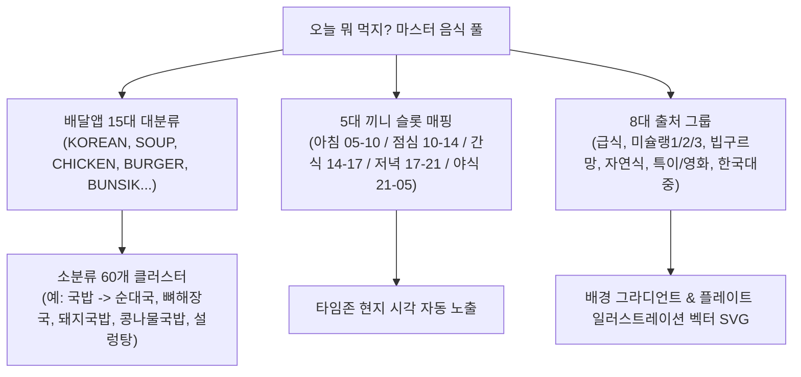

# 📑 음식 데이터 확장 방법론 및 택소노미 체계화 기획서 (Taxonomy Expansion Methodology)

> **프로젝트**: 오늘 뭐 먹지? (`food.tellmyname.app`)  
> **목표**: 115종의 시드 데이터를 기반으로 **배달앱(배달의민족·요기요·쿠팡이츠) 표준 카테고리** 및 **미식·자연식·문화(영화/급식/괴식) 축**을 결합하여 체계적이고 대규모 확장이 가능한 다차원 음식 택소노미 매트릭스를 수립한다.

---

## 1. 확장 배경 및 필요성

1. **사용자 경험의 한계 극복**:
   - 기존 115종으로도 기본적인 추천과 하루 5끼 고유성 검증은 통과했으나, 배달앱을 켜거나 식당을 찾을 때 사용자가 실제로 떠올리는 구체적인 카테고리(예: `족발·보쌈`, `찜·탕`, `아시안`, `카페·디저트`, `샐러드·포케`, `분식`)와 직결되어야 **실제 식사 선택 행동**으로 이어집니다.
2. **배달앱 실전 카테고리와의 1:1 매핑**:
   - 대한민국 배달 3사(배달의민족, 요기요, 쿠팡이츠)의 표준 15대 카테고리를 그대로 차용하여, 오늘 추천받은 음식을 배민이나 쿠팡이츠에서 즉시 검색해 주문할 수 있는 연계성을 확보합니다.
3. **스펙트럼의 균형 (단짠 + 럭셔리 + 자연식 + 문화적 재미)**:
   - 일반 배달음식만 들어가면 지루해지고, 파인다이닝만 들어가면 괴리감이 생깁니다.
   - 따라서 **배달앱 15대 카테고리 × 4대 스펙트럼 레벨(급식/B급괴식 · 대중인기배달 · 빕구르망/노포 · 미슐랭스타/자연식)**의 격자 구조로 확장합니다.

---

## 2. 배달앱 기반 15대 표준 대분류 (`deliveryCategory`)

배달의민족 및 주요 배달 플랫폼의 공식 카테고리를 계승한 15대 카테고리입니다:

| 코드 | 카테고리명 | 배민 표준 매핑 | 대표 세부 메뉴군 |
| :---: | :--- | :--- | :--- |
| **`KOREAN_MEAL`** | 한식·백반·죽 | 1인분 / 한식 / 죽 | 제육볶음, 된장찌개, 김치찌개, 소불고기, 솥밥, 전복죽, 호박죽 |
| **`SOUP_STEW`** | 찜·탕·찌개 | 찜·탕 | 감자탕, 묵은지김치찜, 동태탕, 아구찜, 해물탕, 부대찌개, 곱창전골 |
| **`GUKBAP_NOODLE`** | 국밥·면·칼국수 | 국밥 / 면 | 순대국밥, 뼈해장국, 돼지국밥, 콩나물국밥, 평양냉면, 칼국수, 들기름막국수 |
| **`PORK_FEET_BOSSAM`**| 족발·보쌈 | 족발·보쌈 | 온족발, 직화불족발, 마늘보쌈, 냉채족발, 쟁반막국수 세트 |
| **`MEAT_BBQ`** | 고기·구이 | 고기·구이 | 숙성 삼겹살, 돼지갈비, 우삼겹구이, 한우 채끝스테이크, 닭갈비 |
| **`CHICKEN`** | 치킨 | 치킨 | 후라이드, 양념치킨, 간장골드, 고추바사삭, 수원왕갈비통닭, 닭강정 |
| **`PIZZA_BURGER`** | 피자·버거·양식 | 피자 / 버거 / 양식 | 아이언맨 치즈버거, 화덕피자, 수제버거, 시카고피자, 파스타, 뇨끼 |
| **`CHINESE`** | 중식 | 중식 | 간짜장, 짬뽕, 탕수육, 마파두부, 멘보샤, 마라탕, 꿔바로우, 마라롱샤 |
| **`JAPANESE_DON`** | 돈까스·일식·회 | 돈까스·회·일식 | 치즈돈까스, 연어초밥, 모둠사시미, 카이센동, 텐동, 돈코츠라멘 |
| **`ASIAN_WORLD`** | 아시안·월드푸드 | 아시안 | 소고기 쌀국수, 분짜, 똠얌꿍, 팟타이, 나시고랭, 인도 커리, 타코 |
| **`BUNSIK`** | 분식 | 분식 | 국물떡볶이, 튀김순대세트, 피카츄돈까스, 비빔만두, 참치김밥, 라볶이 |
| **`SALAD_HEALTH`** | 샐러드·포케·자연식 | 샐러드 / 건강식 | 생당근, 설탕토마토, 연어포케, 닭가슴살샐러드, 그릭요거트볼, 곤약김밥 |
| **`CAFE_DESSERT`** | 카페·디저트 | 카페·디저트 | 두바이붕어빵, 소금빵, 인절미빙수, 크로플, 탕후루, 마카롱, 휘낭시에 |
| **`FAST_CONVENIENCE`**| 패스트푸드·편의점 | 패스트푸드 / 편의점 | 불닭게티, 삼각김밥, 황해컵라면핫바, 이삭토스트, 케네디핫도그 |
| **`CINEMA_SPECIAL`** | 영화·드라마·이색별미 | 이색·미식 테마 | 올드보이 군만두, 기생충 채끝짜파구리, 민초탕수육, 공룡알빙수 |

---

## 3. 세부 카테고리(소분류) 60개 클러스터 구조

각 대분류마다 최소 4~6개의 구체적인 소분류(Sub-cluster)를 배정하여 음식이 중복 없이 다채롭게 분산되도록 합니다.

---

## 4. 단계별 데이터 확장 로드맵

1. **1단계 (Phase 1 — 현재 완료)**:
   - 115종 시드 구축 (급식 22종 + 미슐랭 26종 + 빕구르망 10종 + 자연식 15종 + 이색/영화 37종)
2. **2단계 (Phase 2 — 이번 확장 적용)**:
   - 배달앱 15대 카테고리 기준으로 누락된 대표 배달·외식 메뉴 85종 추가 투입 → **총 200종 돌파 (Phase 2 Master)**
   - 추가 대상:
     - 족발/보쌈 (마늘보쌈, 냉채족발, 튀김족발)
     - 찜/탕 (곱창전골, 닭볶음탕, 동태탕, 해물찜)
     - 치킨 (뿌링클, 고추바사삭, 간장치킨, 숯불바베큐치킨)
     - 피자/버거 (화덕 고르곤졸라, 폴드포크 버거, 페퍼로니 디트로이트 피자)
     - 아시안 (분짜, 똠얌꿍, 푸팟퐁커리, 멕시칸 비프 타코)
     - 샐러드/포케 (하와이안 참치 포케, 리코타치즈 샐러드)
     - 분식/카페 (로제떡볶이, 이삭 햄스페셜 토스트, 크룽지, 버터바)
3. **3단계 (Phase 3 — 500종 대규모 확장)**:
   - 전국 8도 로컬 향토 명물 (춘천 닭갈비, 안동 찜닭, 포항 물회, 부산 돼지국밥, 통영 꿀빵 등)
   - 글로벌 스트리트 푸드 (대만 지파이, 터키 케밥, 베트남 반미 등)
