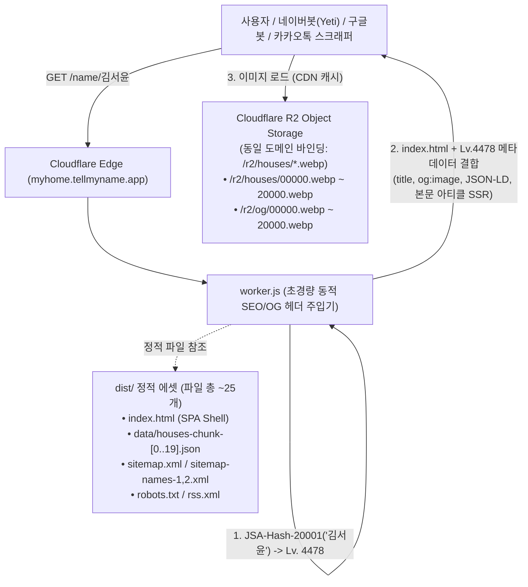

# 🏠 나에게 어울리는 집 (MyHome) — 종합 서비스 및 기술 기획서

- **서비스명**: 나에게 어울리는 집 (`MyHome` — 이름 기반 AI 부동산·우주 건축 감정소)
- **서비스 도메인**: `https://myhome.tellmyname.app`
- **GitHub 저장소**: [`https://github.com/bsj805/myhome`](https://github.com/bsj805/myhome)
- **시드 데이터 연동**: `C:\Users\USER\Documents\projects\name_teller` (25,150개 순수 이름 + 300개 성씨 조합 → **50,000개 시드 이름**)
- **인프라 스택**: Cloudflare Pages / Workers (정적 호스팅 + 파일 개수 무증가 Edge SSR) + **Cloudflare R2 Object Storage** + **Gemini 3.8 Flash**

---

## 0. 핵심 컨셉 및 기획 목표 요약

1. **황당하고 웃긴 극단적 도파민 감정소 (1.1, 1.3, 1.4)**
   - **평범한 아파트·빌라·단독주택은 단 1개도 등장하지 않는다.**
   - **`0단계 ~ 9,999단계 (총 10,000단계)`**: **극단적으로 안 좋은 집 (폭망 하우스)** — 지구의 내핵 옆 원시 동굴, 비에 젖은 택배 종이상자, 세계의 기괴한 공중화장실, 개집, 나니아 옷장 구석, 고장 난 다마스, 아즈카반 독방 등.
   - **`10,000단계 ~ 20,000단계 (총 10,001단계)`**: **극단적으로 좋은 집 (대박 하우스)** — 황금 변기 박물관 펜트하우스, 영화 아이언맨 말리부 저택, 부르즈 할리파 꼭대기, 하울의 움직이는 성, 국제우주정거장(ISS), 다이슨 스피어, 다중우주 창조주의 본가 등.
2. **실제 건축물(짝수) 50% : 허구 건축물(홀수) 50% 완벽 교차 (1.0)**
   - **짝수 단계 (`level % 2 === 0`, 10,001개)**: **실제 존재하는(또는 역사상 실존했던) 기상천외한 건축물·사물·장소**
   - **홀수 단계 (`level % 2 === 1`, 10,000개)**: **허구(상상·SF·판타지·영화/소설/애니·병맛 초현실)의 건축물·사물·장소**
   - 사용자가 `[다음 단계 집 보기 (+1)]` 또는 `[이전 단계 집 보기 (-1)]`를 누를 때마다 **`실제 건축물 ↔ 허구 건축물`**이 1단계 단위로 번갈아 나타나며 끝없는 탐색 재미를 유발한다.
3. **Gemini 3.8 Flash 기반 AI 아트워크 & 병맛 감정서 생성 (1.0, 1.2)**
   - 실제 사진을 무단 크롤링하지 않고, **Gemini 3.8 Flash**를 통해 0~20,000단계 모든 대상(실제 모티프 포함)을 고유한 화풍의 이미지로 그려낸다.
   - 각 집의 사진을 바탕으로 AI가 **① 언제 지어진 집인지(`builtYear`)**, **② 추산되는 가치는 얼마인지(`estimatedValue`)**, **③ 집의 특별한 기능은 무엇인지(`specialFeature`)**를 황당하고 웃기게 지어내어 부동산 감정평가서/등기권리증 형태로 보여준다.
4. **파일 개수를 늘리지 않는 Cloudflare 정적 호스팅 + 50,000개 이름 SEO (2.0, 3.0)**
   - Cloudflare Pages의 정적 파일 개수 제한(20,000개)에 걸리지 않도록 물리적 HTML 파일을 5만 개 생성하지 않고, **단일 SPA 셸(`dist/index.html`) + 경량 청크 JSON + Cloudflare Edge Worker 동적 메타 주입** 구조로 구현한다.
   - `name_teller`의 시드 이름 **50,000개**를 분할 사이트맵(`sitemap-names-1.xml`, `sitemap-names-2.xml`)에 전수 등록하고 네이버(`Yeti`) 및 구글(`Googlebot`) 검색에 완벽 노출시킨다.

---

## 1. 이름 → `0 ~ 20,000` 단계 균등 해시 매핑 설계 및 확률분포 검증 (요구사항 0)

### 1.1 왜 단순 획수 합산(`name_teller` 기본 획수합)만으로는 부족한가?
- 한국어 이름(2~3글자)의 한글 자모 획수는 글자당 `2획(이) ~ 21획(뽜)` 범위에 분포하며, 2~3글자 이름의 총 획수 합은 대다수가 **`6 ~ 40`** 사이에 몰려 있습니다.
- 따라서 단순히 획수를 더하거나 교차 합산(`% 100`)만 수행하면 `0 ~ 20,000` 단계 중 **99.8%의 집이 아무에게도 배정되지 않고**, 수천 명이 똑같은 집을 보게 됩니다.

### 1.2 채택 알고리즘: `JSA-Hash-20001` (자모·획수 아발란체 하이브리드 해시)
`name_teller`(`web/js/match.js`)의 **한글 초·중·종성 획수 테이블(`STROKES`) 및 인접 글자 획수합(`mod 10`) 철학**을 그대로 계승하면서도, 2글자·3글자·4글자 한국어 이름이 `0 ~ 20,000` 전 구간에 수학적으로 완벽히 균등 분포하도록 설계한 **4단계 하이브리드 해시 알고리즘**입니다.

```javascript
// 1단계: 이름 정규화(NFC) 및 음절별 초·중·종성 인덱스 + 자모 획수(sCho, sJung, sJong) 추출
// 2단계: 글자 수(2자/3자/4자)와 총 획수(totalStrokes)를 Golden Ratio 상수(0x9E3779B9)와 시드 믹싱
// 3단계: 각 글자의 (cho, jung, jong, sCho, sJung, sJong, position)을 32비트 레인에 패킹 후 Murmur3 회전 혼합
//        + name_teller 이름점 방식인 인접 글자 획수 조화값((stroke[i] + stroke[i+1]) % 10)을 누적 XOR
// 4단계: fmix32 아발란체 종결자(Avalanche Finalizer) 통과 후 20,001(0 ~ 20,000)로 모듈로 매핑
```

### 1.3 `name_teller` 시드 이름 50,000개 실증 확률분포 테스트 결과
`C:\Users\USER\Documents\projects\name_teller\data\compact_serving_names.json`(25,150개 이름)과 `korean_surnames_all.json`(300개 성씨)을 조합하여 구성한 **50,000개 실전 한국어 이름 데이터셋**(2글자 12,280개 + 3글자 34,548개 + 4글자 복성 3,172개)에 대해 시뮬레이션을 수행한 결과입니다 (`scripts/test_hash_distribution.mjs` 및 `data/hash_distribution_report.json` 참조).

#### 📊 알고리즘별 분포 성능 비교표 ($N = 50,000$, 전체 단계 수 $M = 20,001$)

| 평가 지표 | ① 단순 획수 합산 | ② 획수 다항 해시 | ③ 단순 UTF-16 DJB2 | ④ **JSA-Hash-20001 (채택)** | 이상적 이론치 (Random) |
| :--- | :---: | :---: | :---: | :---: | :---: |
| **점유된 집 단계 수** | 35 / 20,001 | 13,522 / 20,001 | 18,302 / 20,001 | **18,409 / 20,001** | 18,359 / 20,001 |
| **전체 단계 커버리지 (%)** | 0.17% | 67.61% | 91.51% | **92.04%** | 91.79% (포아송 한계) |
| **단일 단계 최대 중복 인원** | 4,548명 | 47명 | 10명 | **10명 (평균 2.5명)** | 10명 |
| **카이제곱 균등성 ($\chi^2$)** | 62,389,403.4 | 104,674.1 | 20,473.9 | **19,873.1** | ~20,000.0 |
| **폭망집 (`0~9,999`) 비율** | 100.00% | 43.38% | 48.52% | **49.83% (24,916명)** | 49.99% |
| **대박집 (`10,000~20,000`) 비율** | 0.00% | 56.62% | 51.48% | **50.17% (25,084명)** | 50.01% |
| **짝수(실제 건축물) 비율** | 50.12% | 49.88% | 50.04% | **49.97% (24,986명)** | 50.00% |
| **홀수(허구 건축물) 비율** | 49.88% | 50.12% | 49.96% | **50.03% (25,014명)** | 50.00% |
| **2글자 이름 평균 단계** | 12.9 | 10,695.9 | 10,308.6 | **9,911.0 (폭망 50.98%)** | 10,000.0 |
| **3글자 이름 평균 단계** | 18.8 | 10,562.5 | 10,088.8 | **10,068.6 (폭망 49.50%)** | 10,000.0 |

#### 📈 `JSA-Hash-20001` 10개 구간(2,000단계 단위) 확률분포 히스토그램
50,000개의 시드 이름이 `0 ~ 20,000` 전 구간에 치우침 없이 **모든 구간 약 10.0%씩 일직선(Uniform Distribution)**으로 매핑됨을 확인했습니다.

| 단계 구간 | 포함 이름 수 (50,000명 중) | 비율 (%) | 구간 성격 |
| :--- | :---: | :---: | :--- |
| **`0 ~ 1,999`** | 4,890명 | **9.78%** | 💀 지옥/원시/길바닥/쓰레기통 하우스 |
| **`2,000 ~ 3,999`** | 4,945명 | **9.89%** | 📦 종이상자/개집/옷장/화장실 하우스 |
| **`4,000 ~ 5,999`** | 5,095명 | **10.19%** | 🏚️ 폐가/흉가/디스토피아/교도소 하우스 |
| **`6,000 ~ 7,999`** | 5,035명 | **10.07%** | 🚗 고장난 탈것/극한 오지/기괴한 자연물 |
| **`8,000 ~ 9,999`** | 4,955명 | **9.91%** | 🎪 황당한 B급 건축물/살기 싫은 기괴 하우스 (폭망 정점) |
| **`10,000 ~ 11,999`** | 4,915명 | **9.83%** | ✨ 기상천외 럭셔리/이색 박물관/성공한 괴짜의 집 (대박 시작) |
| **`12,000 ~ 13,999`** | 5,005명 | **10.01%** | 🏰 세계의 랜드마크/판타지 마법 성채 |
| **`14,000 ~ 15,999`** | 5,100명 | **10.20%** | 🚀 초호화 메가스트럭처/해저·공중 부양 도시 |
| **`16,000 ~ 17,999`** | 5,080명 | **10.16%** | 🪐 행성급 요새/우주정거장/항성 제국 궁전 |
| **`18,000 ~ 20,000`** | 4,980명 | **9.96%** | 🌌 은하계/블랙홀/다중우주 창조주의 초월 신전 |

#### 🔍 실제 시드 이름 매핑 샘플 (성씨 1글자만 달라도 완전히 다른 집 배정)

| 입력 이름 | 글자 수 | 자모 획수 합 (`name_teller` 기준) | 매핑 단계 (`0~20000`) | 등급 구분 | 실제/허구 구분 (`짝/홀`) |
| :--- | :---: | :---: | :---: | :---: | :---: |
| **서윤** | 2글자 | `4 + 6 = 10획` | **Lv. 10,701** | 🌟 대박집 | 홀수 (허구 건축물) |
| **김서윤** | 3글자 | `7 + 4 + 6 = 17획` | **Lv. 4,478** | 💀 폭망집 | 짝수 (실제 건축물) |
| **이서윤** | 3글자 | `2 + 4 + 6 = 12획` | **Lv. 13,131** | 🌟 대박집 | 홀수 (허구 건축물) |
| **박서윤** | 3글자 | `8 + 4 + 6 = 18획` | **Lv. 7,523** | 💀 폭망집 | 홀수 (허구 건축물) |
| **김민준** | 3글자 | `7 + 7 + 7 = 21획` | **Lv. 309** | 💀 폭망집 | 홀수 (허구 건축물) |
| **이민준** | 3글자 | `2 + 7 + 7 = 16획` | **Lv. 15,394** | 🌟 대박집 | 짝수 (실제 건축물) |
| **홍길동** | 3글자 | `6 + 8 + 6 = 20획` | **Lv. 18,224** | 🌟 대박집 | 짝수 (실제 건축물) |
| **선우용녀** | 4글자 | `6 + 3 + 5 + 5 = 19획` | **Lv. 9,025** | 💀 폭망집 | 홀수 (허구 건축물) |

---

## 2. `0단계 ~ 20,000단계` (총 20,001종) 세계관 및 건물 마스터 기획 (요구사항 1, 1.1 ~ 1.4)

### 2.1 3대 절대 설계 원칙
1. **평범함 제로(Zero Normalcy) 원칙**:
   - 대한민국 흔한 30평 아파트, 평범한 원룸, 일반 전원주택은 **단 하나도 넣지 않는다.**
   - 무조건 **"여기서 어떻게 살아?!"(0~9,999단계)** 싶거나, **"이게 집이라고?!"(10,000~20,000단계)** 싶을 정도로 황당하고 웃겨야 한다.
2. **짝수(실제) / 홀수(허구) 1단계 교차 법칙**:
   - **`짝수 단계 (0, 2, 4, ..., 20000)` — 실제 건축물·실제 사물 (10,001종)**: 지구(및 인류 우주 탐사 역사)에 실제로 존재하거나 존재했던 기이한 건축물, 세계의 신기한 화장실, 실제 개집, 보잉 727 개조 주택, 버려진 냉전 미사일 사일로, 구룡성채, 해우재(똥박물관), 룩소르 피라미드 호텔, 부르즈 할리파, 국제우주정거장(ISS), CERN 대형 강입자 충돌기 등.
   - **`홀수 단계 (1, 3, 5, ..., 19999)` — 허구 건축물·상상 공간 (10,000종)**: 영화/애니/소설 속 공간(스폰지밥 파인애플 집, 아즈카반 감옥, 나니아 옷장, 하울의 움직이는 성, 아이언맨 저택), 병맛 초현실 상상 공간(비에 젖은 쿠팡 로켓프레시 은박 보냉백 원룸, 붕어빵 봉투 속 단팥방, 블랙홀 사건의 지평선 뷰 펜트하우스, 다이슨 스피어 등).
3. **비(非)주택 12대 괴짜 카테고리 총망라 (1.3)**:
   - 단순 '집'이 아니라 아래 **12가지 카테고리**를 전 구간에 골고루 배치한다:
     1. 🚽 **화장실/위생시설** (푸세식 변소, 투명 유리 공중화장실, 해우재 변기 박물관, 황금 변기 궁전, 무중력 우주 화장실)
     2. 🚪 **옷장/가구/수납함** (이케아 조립 실패 옷장, 나니아 연대기 옷장, 코인사물함 13번 칸, 루이비통 트렁크 타워)
     3. 🐶 **개집/동물 서식지** (플라스틱 바둑이 개집, 비버 댐, 황실 코기 전용 별장, 패리스 힐튼 강아지 맨션)
     4. 📦 **종이상자/포장재/용기** (비 맞은 라면 박스, 쿠팡 프레시 보냉백, 아마존 컨테이너 박스 성채, 티파니 보석함 하우스)
     5. 🚗 **자동차/탈것/기계** (폐차 직전 마티즈 뒷좌석, 쇼핑카트, 1970년대 녹슨 잠수함, 보잉 747 전용기 하우스, 설국열차 1호칸)
     6. 🚀 **우주선/우주 구조물** (아폴로 13호 구명정, 머스크의 테슬라 로드스터 우주선, 국제우주정거장 ISS, 엔터프라이즈호, 다이슨 스피어)
     7. 🎬 **영화/소설/애니 속 공간** (해리포터 계단 밑 벽장, 아즈카반, 반지의 제왕 호빗굴, 하울의 움직이는 성, 어벤져스 타워, 아스가르드)
     8. 🏛️ **박물관/기괴한 공공건물** (체르노빌 폐병원, 똥박물관, 라면박물관, 구겐하임 미술관, 루브르 유리 피라미드, 스발바르 종자저장고)
     9. 🏙️ **상상 속의 도시/미니어처** (개미집 지하도시, 레고 브릭 시티, 아틀란티스 수중도시, 사이버펑크 네온 메가시티, 천공의 성 라퓨타)
     10. 🪨 **극한 자연물/기후 지형** (마리아나 해구 심해 열수구, 활화산 분화구 턱밑, 시베리아 영구동토층 얼음굴, 에베레스트 베이스캠프 텐트)
     11. 🏰 **세계의 기이한 실제 건축물** (폴란드 거꾸로 된 집, 캔자스시티 도서관 책 모양 건물, 오하이오 바스켓 빌딩, 싱가포르 마리나 베이 샌즈)
     12. 🌌 **초차원/다중우주 신전** (4차원 테서랙트 큐브 방, 시간의 방, 블랙홀 특이점 펜트하우스, 시뮬레이션 우주 서버실 메인프레임)

---

### 2.2 `0단계 ~ 20,000단계` (20개 티어 × 1,000단계) 마스터 컨셉트 블루프린트

#### 🔴 PART 1: 극단적으로 안 좋은 집 (`0단계 ~ 9,999단계` — 폭망 하우스 구간)

| 티어 (단계 범위) | 구간 테마 | 건축 연도 스펙트럼 | 추산 가치 스펙트럼 | 짝수(실제 건축물/사물) 대표 컨셉트 | 홀수(허구/상상/영화) 대표 컨셉트 | AI 병맛 특수 기능 예시 |
| :--- | :--- | :--- | :--- | :--- | :--- | :--- |
| **Tier 01**<br>`0 ~ 999`<br>*(태초의 밑바닥)* | **멸종·풍찬노숙·미생물 서식지** | 기원전 45억 년 ~ 기원전 1만 년 (또는 어제 버려짐) | **-999억 원(원상복구 벌금) ~ 0원** | • **Lv.0**: 인도네시아 카와이젠 유황 광산 옆 1인용 바위 틈새<br>• **Lv.2**: 시베리아 오이미야콘 영하 67도 야외 나무 푸세식 화장실<br>• **Lv.500**: 실제 태평양 거대 쓰레기 섬(GPGP) 위 플라스틱 부표 | • **Lv.1**: 지구 맨틀과 외핵 사이 마그마 반지하 단칸방<br>• **Lv.3**: 공룡 티라노사우루스 어금니 사이 충치 동굴<br>• **Lv.999**: 바퀴벌레 제국 황실 하수구 3번 배관 원룸 | • `"난방비 평생 0원(바닥에서 4,000℃ 용암이 직접 올라옴)"`<br>• `"비 오면 집 전체가 태평양으로 자동 출항함"` |
| **Tier 02**<br>`1,000 ~ 1,999`<br>*(종이상자·쓰레기통)* | **골판지·포장재·분리수거함** | 2024년 화요일 오후 ~ 3일 전 | **10원 ~ 4,500원 (고물상 폐지 시세)** | • **Lv.1000**: 장마철 골목길에 내놓은 김치냉장고 대왕 골판지 상자<br>• **Lv.1200**: 실제 일본 캡슐호텔 초기형 0.3평 플라스틱 관짝 방<br>• **Lv.1800**: 폐기된 공중전화 부스 개조 간이 대피소 | • **Lv.1001**: 쿠팡 로켓프레시 은박 보냉백 2개 이어 붙인 복층 펜트하우스<br>• **Lv.1201**: 스폰지밥 징징이가 버린 클라리넷 케이스 속 침실<br>• **Lv.1999**: 슈뢰딩거의 고양이 실험용 납 상자 (열기 전까지 생사불명) | • `"장마철 습도 100% 달성 시 지붕이 죽처럼 녹아내리는 친환경 자연분해 기능"`<br>• `"경비원이 매주 수요일 분리수거 차에 집째로 실어감"` |
| **Tier 03**<br>`2,000 ~ 2,999`<br>*(개집·옷장·사물함)* | **반려동물 집·좁은 가구·벽장** | 1998년 ~ 2026년 | **8,000원 ~ 19만 원 (당근마켓 나눔가)** | • **Lv.2000**: 시골 마당 빨간 지붕 플라스틱 진돗개 집 (특대형)<br>• **Lv.2400**: 지하철 2호선 강남역 물품보관함 42번 대형 칸<br>• **Lv.2800**: 이케아(IKEA) 팍스(PAX) 옷장 전시 코너 구석 | • **Lv.2001**: 『해리포터』 더즐리네 계단 밑 거미줄 벽장<br>• **Lv.2401**: 『나니아 연대기』 옷장인데 눈의 여왕 대신 겨울 바람만 부는 고장 난 옷장<br>• **Lv.2999**: 고양이 5마리가 점거한 7단 캣타워 맨 아래층 구석 | • `"집주인(백구)이 밥그릇 건드리면 즉시 강제 퇴거 조치함"`<br>• `"다리를 펴고 자면 발목이 자동으로 2호선 개찰구 밖으로 나감"` |
| **Tier 04**<br>`3,000 ~ 3,999`<br>*(기괴한 화장실·하수시설)* | **세계의 황당한 화장실·목욕탕** | 1950년 ~ 2023년 | **20만 원 ~ 350만 원** | • **Lv.3000**: 일본 도쿄 시부야 '투명 유리 공중화장실' (전기 끊기면 투명해짐)<br>• **Lv.3400**: 수원 '해우재(똥박물관)' 거대 변기 모양 건물 보일러실<br>• **Lv.3800**: 알프스 절벽 끝 낭떠러지 이동식 간이 화장실 | • **Lv.3001**: 『해리포터』 모우닝 머틀이 24시간 통곡하는 여자 화장실 3번째 칸<br>• **Lv.3401**: 스키비디 토일렛이 노래 부르는 무한 역류 황동 변기 하우스<br>• **Lv.3999**: 물 내리면 아틀란티스 하수처리장으로 직통 워프하는 양변기 방 | • `"정전 발생 시 사방 벽면이 100% 투명 유리로 전환되어 동네 인싸 등극"`<br>• `"하루 48번 자동으로 물 내려가는 워터파크형 수면 시스템"` |
| **Tier 05**<br>`4,000 ~ 4,999`<br>*(폐가·교도소·디스토피아)* | **흉가·독방·철거 직전 건물** | 1890년 ~ 1986년 | **500만 원 ~ 2,900만 원 (철거비 별도)** | • **Lv.4000**: 홍콩 구룡성채(Kowloon Walled City) 햇빛 0% 12층 치과 옆 단칸방<br>• **Lv.4400**: 미국 알카트라즈 해상 교도소 B동 독방<br>• **Lv.4800**: 우크라이나 체르노빌 프리피야트 폐놀이공원 범퍼카 매표소 | • **Lv.4001**: 『해리포터』 디멘터가 순찰 도는 아즈카반 북해 꼭대기 방<br>• **Lv.4401**: 영화 『곤지암』 402호 원장실 (문고리가 안쪽에서 잠김)<br>• **Lv.4999**: 영화 『플랫폼(The Platform)』 수직 감옥 지하 333층 방 | • `"밤 12시마다 전 세입자(귀신)가 나타나 월세 반반 내자고 조름"`<br>• `"가이거 계수기가 자장가 대신 신나는 비프음을 연주함"` |
| **Tier 06**<br>`5,000 ~ 5,999`<br>*(고장 난 탈것·폐기계)* | **폐차·난파선·고장 난 이동수단** | 1972년 ~ 2010년 | **3,000만 원 ~ 6,500만 원** | • **Lv.5000**: 바퀴 3개 빠진 1999년식 황금색 마티즈 뒷좌석 차박 하우스<br>• **Lv.5400**: 투르크메니스탄 '지옥의 문' 가스 분화구 옆 녹슨 소련제 트레일러<br>• **Lv.5800**: 코스타리카 정글 나무 위에 불시착한 실제 1965년형 보잉 727 폐동체 | • **Lv.5001**: 영화 『설국열차』 단백질 블록 공장 바로 옆 꼬리칸 침대<br>• **Lv.5401**: 『매드맥스』 워보이가 운전하는 V8 배기구 바로 위 해골 해먹<br>• **Lv.5999**: 타이타닉호 빙산 충돌 5분 전 3등석 보일러실 옆방 | • `"시속 0km로 달리는 평생 무사고 보증(엔진이 아예 없음)"`<br>• `"클락션 누르면 와이퍼 대신 트렁크가 열리며 빗물 받아줌"` |
| **Tier 07**<br>`6,000 ~ 6,999`<br>*(극한 오지·기괴한 자연)* | **절벽·사막·화산·빙하 위 고립 가옥** | 기원전 500년 ~ 2015년 | **7,000만 원 ~ 1억 5,000만 원** | • **Lv.6000**: 세르비아 드리나강 한가운데 바위 위 '강 위의 외딴집' (홍수 나면 떠내려감)<br>• **Lv.6400**: 조지아 카츠히 기둥(40m 수직 석회암 절벽 꼭대기) 위 수도원 오두막<br>• **Lv.6800**: 아이슬란드 엘리다에이 무인도 외딴집 (배 없으면 편의점 왕복 3일) | • **Lv.6001**: 『마인크래프트』 용암 바다 한가운데 흙블록 1칸 위 집 (크리퍼 대기 중)<br>• **Lv.6401**: 『걸리버 여행기』 거인국 식탁 위 수프 그릇 옆 각설탕 이글루<br>• **Lv.6999**: 화성 올림푸스 화산 꼭대기 산소통 1개 남은 감자 비닐하우스 | • `"배달의민족 주문 시 라이더가 헬기 타고 오며 배달팁 4,800만 원 부과"`<br>• `"집 밖으로 한 발짝만 잘못 디디면 즉시 스카이다이빙 체험 가능"` |
| **Tier 08**<br>`7,000 ~ 7,999`<br>*(세계의 황당한 B급 건축물)* | **기괴한 모양의 실제 건물·착시 하우스** | 1980년 ~ 2022년 | **1억 6,000만 원 ~ 3억 원** | • **Lv.7000**: 폴란드 심바르크 '거꾸로 지어진 집(Upside Down House)' (천장에 가구 붙어있음)<br>• **Lv.7400**: 영국 옥스퍼드 지붕에 실물 상어 동상이 처박힌 '헤딩턴 샤크 하우스'<br>• **Lv.7800**: 폴란드 소포트 술 취한 듯 찌그러진 '크지비 도메크(비틀린 집)' | • **Lv.7001**: 에셔(M.C. Escher)의 무한 계단 집 (화장실 가려고 내려가면 다시 안방 천장으로 나옴)<br>• **Lv.7401**: 『스폰지밥』 비키니 시티 바위 밑 뚱이네 집 (가구 전부 모래로 만듦)<br>• **Lv.7999**: 피사의 사탑보다 84도 더 기울어져 굴러가기 직전인 젠가 타워 하우스 | • `"집 안 모든 바닥이 35도 기울어져 있어 자고 일어나면 자동으로 현관문 앞에 굴러와 있음"`<br>• `"방문객 100%가 입구에서 멀미약 2알 먹고 입장해야 함"` |
| **Tier 09**<br>`8,000 ~ 8,999`<br>*(극단적 미니하우스·기괴 박물관)* | **1평 건축·거대 사물형 건물** | 1995년 ~ 2025년 | **3억 1,000만 원 ~ 5억 원** | • **Lv.8000**: 폴란드 바르샤바 건물 틈새 폭 92cm 세계에서 가장 좁은 '케레트 하우스'<br>• **Lv.8400**: 미국 아이다호 실제 6톤짜리 거대 감자 모형 호텔 '빅 아이다호 포테이토 호텔'<br>• **Lv.8800**: 미국 텍사스 주전자 모양 건물(Teapot Dome) 다락방 | • **Lv.8001**: 『진격의 거인』 월 마리아 성벽 틈새에 낀 거인의 콧구멍 원룸<br>• **Lv.8401**: 거대 컵라면(신라면 큰사발) 용기 안 건더기 스프 위 뗏목 하우스<br>• **Lv.8999**: 『찰리와 초콜릿 공장』 움파룸파 숙소 옆 녹아내리는 캐러멜 창고 | • `"어깨 넓은 친구가 놀러 오면 건물 양쪽 외벽에 껴서 119 구조대 불러야 함"`<br>• `"여름철 직사광선 받으면 집에서 맛있는 구운 감자 냄새가 진동함"` |
| **Tier 10**<br>`9,000 ~ 9,999`<br>*(안 좋은 집의 최종 보스)* | **돈은 비싼데 절대 살기 싫은 저주받은 기괴 하우스** | 1884년 ~ 2026년 | **5억 1,000만 원 ~ 9억 9,999만 원 (매도 불가)** | • **Lv.9000**: 미국 산호세 '윈체스터 미스터리 하우스' (방 160개, 문을 열면 낭떠러지나 벽이 나옴)<br>• **Lv.9400**: 미국 오하이오 7층짜리 거대 피크닉 바구니 빌딩(Longaberger Basket Building)<br>• **Lv.9998**: 북한 평양 류경호텔 105층 미완공 시멘트 꼭대기 펜트하우스 (엘리베이터 없음) | • **Lv.9001**: 『오징어 게임』 유리 징검다리 세트장 한가운데 강화유리 거실<br>• **Lv.9401**: 『심슨 가족』 스프링필드 원자력 발전소 냉각탑 바로 안쪽 수상 가옥<br>• **Lv.9999**: 9,999단계 폭망의 정점 — 황금으로 도배했지만 화장실이 105층 계단 아래에 있는 무엘리베이터 바벨탑 옥탑방 | • `"집값은 9억인데 엘리베이터가 없어 택배 시키면 1층부터 105층까지 등산해야 함"`<br>• `"방이 160개라 안방에서 화장실 찾아가다 집 안에서 조난당함"` |

---

#### 🔵 PART 2: 극단적으로 좋은 집 (`10,000단계 ~ 20,000단계` — 대박 하우스 구간)

| 티어 (단계 범위) | 구간 테마 | 건축 연도 스펙트럼 | 추산 가치 스펙트럼 | 짝수(실제 건축물/사물) 대표 컨셉트 | 홀수(허구/상상/영화) 대표 컨셉트 | AI 병맛 특수 기능 예시 |
| :--- | :--- | :--- | :--- | :--- | :--- | :--- |
| **Tier 11**<br>`10,000 ~ 10,999`<br>*(좋은 집 입문·괴짜 부자)* | **성공한 덕후의 벙커·초호화 이색 하우스** | 2015년 ~ 2035년 | **10억 원 ~ 49억 원** | • **Lv.10000**: 미국 캔자스 지하 15층 핵미사일 사일로를 개조한 초호화 '서바이벌 콘도'(수영장·영화관 완비)<br>• **Lv.10400**: 네덜란드 암스테르담 실제 대형 항만 크레인 꼭대기 스위트룸 '파랄다 크레인 호텔'<br>• **Lv.10800**: 스웨덴 유카스예르비 100% 천연 빙하로 조각한 최고급 '아이스호텔 로열 스위트' | • **Lv.10001**: 『배트맨』 웨인 저택 지하 폭포 뒤 초호화 배트케이브 (슈퍼컴퓨터+배트모빌 주차장)<br>• **Lv.10401**: 『포켓몬스터』 잠만보 배 위에서 낮잠 자는 폭신폭신 최고급 구름 펜트하우스<br>• **Lv.10999**: 전 세계 모든 치킨 브랜드 본사가 1층에 입점해 있는 '황금 올리브유 분수 대저택' | • `"좀비 아포칼립스 발생 시 지하 15층에서 팝콘 먹으며 넷플릭스 100년 시청 가능"`<br>• `"수도꼭지 온수 방향을 돌리면 1급수 대신 갓 튀긴 양념치킨 소스가 나옴"` |
| **Tier 12**<br>`11,000 ~ 11,999`<br>*(초호화 모빌리티·박물관)* | **억만장자의 이동식 궁전·세계적 예술 건축** | 2020년 ~ 2045년 | **50억 원 ~ 199억 원** | • **Lv.11000**: 스페인 빌바오 프랭크 게리 설계 티타늄 곡선 건축물 '구겐하임 미술관' VIP 관장실<br>• **Lv.11400**: 사우디 왕자용 에어버스 A380 '하늘을 나는 3층 황금 궁전 전용기'<br>• **Lv.11800**: 오스트리아 20억 원짜리 24K 금장 슈퍼카 주차 엘리베이터가 달린 '엘레멘테 무빌(창문으로 산맥이 열리는 캠핑카)' | • **Lv.11001**: 지브리 『하울의 움직이는 성』 풀옵션 리모델링 버전 (문고리 돌리면 강남·파리·하와이 즉시 이동)<br>• **Lv.11401**: 『원피스』 밀짚모자 해적단 사우전드 써니호 VIP 수족관 라운지<br>• **Lv.11999**: 루이비통 모노그램 다이아몬드로 외벽을 마감한 12층짜리 걸어 다니는 명품 트렁크 성 | • `"출근하기 싫을 때 집 문고리 색깔만 바꾸면 현관문이 회사 탕비실로 바로 연결됨"`<br>• `"층간소음 나면 집 자체가 날개를 펴고 성층권으로 이륙함"` |
| **Tier 13**<br>`12,000 ~ 12,999`<br>*(영화 속 억만장자 저택)* | **절벽 위 하이테크 맨션·동화 속 왕국 성** | 1869년 ~ 2060년 | **200억 원 ~ 999억 원** | • **Lv.12000**: 독일 바이에른 디즈니 성의 실제 모델 '노이슈반슈타인 성(Neuschwanstein Castle)' 통째 소유<br>• **Lv.12400**: 미국 캘리포니아 절벽 위 실제 '레이저 하우스(Razor House — 아이언맨 저택 실제 촬영지)'<br>• **Lv.12800**: 프랑스 파리 루브르 박물관 중앙 '유리 피라미드' 지하 독점 펜트하우스 | • **Lv.12001**: 『아이언맨』 토니 스타크 말리부 절벽 저택 + 자비스(J.A.R.V.I.S) AI 집사 & 마크85 아머 옷장<br>• **Lv.12401**: 『겨울왕국』 엘사가 지은 100% 다이아몬드 강도 얼음 궁전 (감기 절대 안 걸림)<br>• **Lv.12999**: 『위대한 개츠비』 매일 밤 샴페인 폭포가 쏟아지는 황금 대저택 | • `"옷 입기 귀찮을 때 바닥에서 로봇 팔 12개가 올라와 3초 만에 아이언맨 수트 입혀줌"`<br>• `"거실 벽에 걸린 진품 모나리자가 눈 마주치면 오늘 날씨 브리핑해 줌"` |
| **Tier 14**<br>`13,000 ~ 13,999`<br>*(세계 7대 불가사의·초고층)* | **마천루 최상층·고대 제국 불가사의** | 기원전 2560년 ~ 2080년 | **1,000억 원 ~ 9,999억 원** | • **Lv.13000**: 인도 뭄바이 세계에서 가장 비싼 개인 주택 27층 '안틸리아(Antilia — 직원 600명 상주)'<br>• **Lv.13400**: 두바이 세계 최고층 빌딩 '부르즈 할리파(828m)' 첨탑 꼭대기 독점 스카이 라운지<br>• **Lv.13800**: 싱가포르 마리나 베이 샌즈 57층 공중 선박 인피니티풀 전체 전세 하우스 | • **Lv.13001**: 마블 『어벤져스』 스타크 타워 최상층 펜트하우스 (퀸젯 전용 발착장 포함)<br>• **Lv.13401**: 『반지의 제왕』 요정들의 불멸의 계곡 '리벤델( 깊은골)' 폭포수 황금 궁전<br>• **Lv.13999**: 이집트 피라미드 꼭대기에 반중력 황금 부양석을 얹은 파라오의 태양신 펜트하우스 | • `"집에만 가만히 있어도 전담 집사 600명이 눈 깜빡일 때마다 포도알을 입에 넣어줌"`<br>• `"베란다 인피니티풀에서 헤엄치면 구름 위를 산책하는 기분 만끽"` |
| **Tier 15**<br>`14,000 ~ 14,999`<br>*(수중·공중·극지 메가스트럭처)* | **해저 호텔·인류 최후의 방주·미래 도시** | 2030년 ~ 2150년 | **1조 원 ~ 99조 원** | • **Lv.14000**: 몰디브 콘래드 호텔 인도양 수심 5m 통유리 해저 빌라 '더 무라카(The Muraka)'<br>• **Lv.14400**: 노르웨이 북극권 '스발바르 국제종자저장고(인류 최후의 날 방주)' VIP 통제 구역<br>• **Lv.14800**: 사우디아라비아 네옴시티(NEOM) 길이 170km 거울 장벽 메가시티 '더 라인(The Line)' 왕실 구역 | • **Lv.14001**: 『아쿠아맨』 아틀란티스 해저 제국 왕궁 (고래가 리무진 대신 마중 나옴)<br>• **Lv.14401**: 지브리 『천공의 성 라퓨타』 비행석으로 하늘에 떠 있는 고대 공중 정원 성채<br>• **Lv.14999**: 『사이버펑크 2077』 나이트시티 아라사카 타워 최상층 궤도 정거장 뷰 궁전 | • `"창밖으로 상어와 대왕고래가 지나가며 아침 인사를 건네는 천연 아쿠아리움 뷰"`<br>• `"소행성 충돌이나 빙하기가 와도 혼자 따뜻한 온천수 받으며 샤인머스캣 재배 가능"` |
| **Tier 16**<br>`15,000 ~ 15,999`<br>*(거대 과학시설·인공섬 왕국)* | **초거대 과학 요새·개인 소유 인공섬** | 2040년 ~ 2300년 | **100조 원 ~ 999조 원** | • **Lv.15000**: 스위스-프랑스 국경 지하 100m 둘레 27km 'CERN 대형 강입자 충돌기(LHC)' 중심부 하이테크 레지던스<br>• **Lv.15400**: 미국 애플 본사 우주선 모양 거대 링 빌딩 '애플 파크(Apple Park)' 통째 개인 별장화<br>• **Lv.15800**: 두바이 '팜 주메이라(야자수 인공섬)' 전체를 앞마당 정원으로 쓰는 해상 황궁 | • **Lv.15001**: 마블 『블랙 팬서』 와칸다 비브라늄 광산 위 초과학 왕궁 & 자기부상 열차 침실<br>• **Lv.15401**: 『드래곤볼』 카린탑 꼭대기 위 신의 궁전 (선두 무제한 리필 항아리 기본 옵션)<br>• **Lv.15999**: 태평양 한가운데 다이아몬드 원석으로만 쌓아 올린 개인 소유 부양 대륙 | • `"아침마다 반물질 입자가속기로 에스프레소를 0.0001초 만에 추출해 줌"`<br>• `"피곤할 때 부엌 찬장에서 '선두' 한 알 꺼내 먹으면 30년 치 피로가 1초 만에 회복됨"` |
| **Tier 17**<br>`16,000 ~ 16,999`<br>*(궤도 우주정거장·달 기지)* | **지구 궤도 펜트하우스·달 분화구 성채** | 2050년 ~ 2800년 | **1경 원 ~ 99경 원** | • **Lv.16000**: 지구 상공 400km '국제우주정거장(ISS)' 큐폴라(Cupola) 7면 지구 통유리 전망대 독점 하우스<br>• **Lv.16400**: 중국 구이저우 지름 500m 세계 최대 전파망원경 '톈옌(FAST)' 중앙 외계 신호 수신 펜트하우스<br>• **Lv.16800**: NASA 아르테미스 계획 '루나 게이트웨이(달 궤도 우주정거장)' 사령관실 | • **Lv.16001**: 『스타트렉』 U.S.S. 엔터프라이즈호 워프 코어 뷰 함장 특실 & 홀로덱(상상하는 모든 방 즉시 구현)<br>• **Lv.16401**: 달의 뒷면 '고요의 바다' 위 헬륨-3 크리스탈로 지은 반중력 유리 돔 궁전<br>• **Lv.16999**: 『기동전사 건담』 사이드7 스페이스 콜로니 전체를 통째로 전세 낸 무중력 대저택 | • `"90분마다 지구를 한 바퀴씩 돌아 하루에 일출과 일몰을 16번 감상하는 갓생 뷰"`<br>• `"체중계에 올라가면 무중력 덕분에 몸무게가 항상 0kg으로 표시되는 기적의 다이어트 하우스"` |
| **Tier 18**<br>`17,000 ~ 17,999`<br>*(행성 테라포밍·태양계 황궁)* | **화성 수도·토성 고리 리조트·행성 요새** | 2900년 ~ 5000년 | **100경 원 ~ 9,999경 원** | • **Lv.17000**: 스페이스X(SpaceX) 스타십 1,000대를 연결해 화성 아카디아 평원에 세운 실사형 '마스 베이스 알파' 중앙 청사<br>• **Lv.17400**: 제임스 웹 우주망원경(JWST) 18각 순금 거울 위 라그랑주 L2 포인트 황금 별장<br>• **Lv.17800**: 보이저 1호 골든 레코드가 도달한 성간 우주(Interstellar Space) 전초기지 | • **Lv.17001**: 『스타워즈』 행성 크기의 우주 요새 '데스스타(Death Star)' 황제 알현실 펜트하우스<br>• **Lv.17401**: 토성 고리(얼음과 다이아몬드 입자) 위에 건설된 360도 파노라마 우주 카지노 리조트<br>• **Lv.17999**: 목성 대적점 소용돌이 위에 떠 있는 다이아몬드 비(Rain) 채집 공중 궁전 | • `"비가 내릴 때마다 물방울 대신 10캐럿짜리 천연 다이아몬드 우박이 마당에 쌓임"`<br>• `"보일러 스위치 누르면 옆 동네 소행성을 레이저로 구워서 복사열로 난방함"` |
| **Tier 19**<br>`18,000 ~ 18,999`<br>*(항성 엔지니어링·신화적 성역)* | **태양을 감싼 다이슨 스피어·신들의 거처** | 서기 10,000년 ~ 50,000년 | **1해 원 ~ 9,999해 원 (은하계 GDP의 30%)** | • **Lv.18000**: 실제 천체물리학자 프리먼 다이슨이 설계한 항성 에너지 100% 포획 구체 '다이슨 스피어(Dyson Sphere)' 중앙 통제궁<br>• **Lv.18400**: 처녀자리 은하단 중심 M87 초대질량 블랙홀(인류 최초 촬영 성공 블랙홀) 제트 방출구 관측 요새<br>• **Lv.18800**: 독수리 성운 '창조의 기둥(Pillars of Creation — 7,000광년 높이 성간 가스 기둥)' 꼭대기 천문대 | • **Lv.18001**: 마블 『토르』 무지개 다리(비프로스트)가 현관문 앞에 깔린 황금빛 '아스가르드 왕궁'<br>• **Lv.18401**: 영화 『인터스텔라』 가르강튀아 블랙홀 내부 5차원 테서랙트(Tesseract) 서재 하우스<br>• **Lv.18999**: 『드래곤볼 슈퍼』 전왕(우주 최고신)의 해파리 모양 우주 궁전 | • `"전기세 걱정 제로: 집 지하실 보일러에 태양(항성) 1개가 통째로 들어있음"`<br>• `"책장 뒤를 두드리면 과거의 나에게 로또 1등 당첨 번호를 모스 부호로 보내줄 수 있음"` |
| **Tier 20**<br>`19,000 ~ 20,000`<br>*(다중우주 정점·창조주의 본가)* | **시공간 초월·빅뱅 설계실·20,000단계 최종 정점** | 태초 이전 ~ 시간의 끝 (영원) | **측정 불가 (우주 12개 + 안드로메다 은하 일시불)** | • **Lv.19000**: 관측 가능한 우주 거대구조 '라니아케아 초은하단(Laniakea Supercluster — 은하 10만 개 집합체)' 중심 중력원(Great Attractor) 본부<br>• **Lv.19998**: 우주배경복사(CMB) 너머 빅뱅 직후 138억 년 전 최초의 빛으로 지어진 '플랑크 시대 태초의 성소'<br>• **Lv.20000 (최종 보스 짝수)**: **관측 가능한 우주 전체(지름 930억 광년)를 거실 스노우볼로 올려놓은 '관측 가능한 우주 박물관 최상층 펜트하우스'** | • **Lv.19001**: 『닥터 스트레인지』 모든 멀티버스의 차원문이 열리는 '생텀 생토럼' 상위 버전 '운명의 성채'<br>• **Lv.19999 (최종 보스 홀수)**: **우주 시뮬레이션 서버실 메인프레임 옥상 — 마우스 클릭 한 번으로 물리법칙과 월요일을 삭제할 수 있는 창조주의 게이밍 룸** | • `"집안 리모컨에 [월요일 삭제], [중력 끄기], [빅뱅 재부팅] 버튼이 기본 탑재됨"`<br>• `"거실 어항 속에 은하계 2조 개가 헤엄치고 있으며 관리비는 우주가 대신 냄"` |

---

### 2.3 Gemini 3.8 Flash 기반 멀티모달 생성 규격 (요구사항 1.0, 1.2)

1. **이미지 생성 모델**: `gemini-3.8-flash` (또는 이미지 생성 엔드포인트)
   - 실제 건물의 사진을 무단 복제하지 않고, **짝수 단계(실제 건축물 모티프)**는 `"Architectural hyper-detailed satirical illustration / surreal editorial photography of [실제 건축물 명칭 및 특징]"` 스타일로, **홀수 단계(허구 건축물)**는 `"Cinematic absurd fantasy/sci-fi concept art of [허구 공간 묘사]"` 스타일로 일관된 고해상도 WebP(`1024×1024` 및 OG 카드용 `1200×630`)로 렌더링한다.
2. **AI 감정평가서 JSON 스키마 (20,001개 단계 사전 생성 및 서빙)**:
   ```json
   {
     "level": 4478,
     "zone": "BAD",
     "realityType": "REAL",
     "category": "PRISON_RUIN",
     "title": "체르노빌 프리피야트 폐유원지 관람차 4번 곤돌라",
     "builtYear": "1986년 4월 25일 (개장 하루 전 영구 휴장)",
     "estimatedValue": "고철값 42,800원 (방사능 제염 비용 14억 원 본인 부담)",
     "specialFeature": "밤마다 형광 녹색 자체 발광 무드등이 켜져 전기세가 0원이며, 관람차가 바람에 흔들릴 때마다 360도 파노라마 폐허 뷰를 제공합니다.",
     "aiVerdict": "축하합니다! 전 세계에서 가장 스릴 넘치는 고공 자연인의 삶에 당첨되셨습니다.",
     "imageUrl": "/r2/houses/04478.webp"
   }
   ```

---

## 3. Cloudflare 정적 호스팅 + R2 + 무파일 확장형 SEO 아키텍처 (요구사항 2, 3, 4)

### 3.1 왜 물리적 HTML 파일을 50,000개 만들면 안 되는가?
- Cloudflare Pages/Workers Assets는 배포당 **최대 파일 개수 제한(20,000개)**이 존재합니다.
- 또한 "파일 개수를 늘리지 않고 Cloudflare 정적 호스팅 해야 한다"는 요구사항을 완벽히 만족하려면, 빌드 산출물(`dist/`)의 물리적 파일 수는 **총 30개 이내**로 유지하면서 50,000개 이름 URL과 20,001개 집 단계를 모두 서빙해야 합니다.

### 3.2 아키텍처 다이어그램 (Zero-File-Explosion Static + Edge SSR + R2)



### 3.3 디렉토리 및 배포 파일 구조 (`dist/` 총 파일 개수 ~28개 유지)
```text
myhome/
├── dist/                                      # Cloudflare 정적 호스팅 배포 폴더 (파일 개수 ~28개!)
│   ├── index.html                             # 단일 SPA 웹앱 셸 (검색 + 감정서 카드 + 이전/다음/랜덤 탐색)
│   ├── data/
│   │   └── houses-chunk-00.json ~ 19.json     # 20,001개 집 메타데이터 (1,000개씩 20개 청크 분할, 청크당 ~150KB)
│   ├── sitemap.xml                            # 사이트맵 인덱스 (sitemap-names-1.xml, sitemap-names-2.xml 연결)
│   ├── sitemap-names-1.xml                    # name_teller 시드 이름 1 ~ 25,000번 URL
│   ├── sitemap-names-2.xml                    # name_teller 시드 이름 25,001 ~ 50,000번 URL
│   ├── robots.txt                             # Naver Yeti, Googlebot 전면 허용 + Sitemap 명시
│   ├── rss.xml                                # 네이버 서치어드바이저 RSS 제출용 피드
│   └── ads.txt / privacy.html / terms.html    # 애드센스 및 법적 고지
├── worker.js                                  # /name/:name 및 /level/:level 요청 시 동적 SEO/OG 주입
├── wrangler.toml                              # myhome.tellmyname.app 도메인 및 R2 바인딩 설정
└── scripts/
    ├── test_hash_distribution.mjs             # name_teller 5만 개 이름 해시 확률분포 검증기
    ├── generate_houses_dataset.mjs            # Gemini 3.8 Flash 20,001종 집 메타/이미지 배치 생성기
    ├── upload_r2_images.mjs                   # Cloudflare R2 이미지 일괄 업로드 스크립트
    └── generate_static_site.mjs               # dist/ 빌드 및 50,000개 Sitemap 생성기
```

---

## 4. 네이버(Naver) & 구글 검색엔진 최적화(pSEO) 및 50,000개 Sitemap 전략

### 4.1 URL 라우팅 규격 (요구사항 2)
- **기본 도메인**: `https://myhome.tellmyname.app`
- **이름 전용 영구 URL**: `https://myhome.tellmyname.app/name/{이름}` (예: `https://myhome.tellmyname.app/name/김서윤`)
  - 같은 이름으로 접속하면 언제 어디서나 **100% 동일한 단계(`0~20,000`)와 동일한 집 이미지·감정평가서**가 노출된다.
  - 단축 경로 `https://myhome.tellmyname.app/{이름}` 입력 시에도 `/name/{이름}`으로 정규화(Canonical) 처리.
- **단계 탐색 URL**: `https://myhome.tellmyname.app/level/{0~20000}` (또는 `?level=10701&from=서윤`)
  - 내 이름의 집을 확인한 뒤 `[◀ 이전 단계 집 보기]`, `[다음 단계 집 보기 ▶]`, `[🎲 랜덤 집 보기]`를 누르며 0~20,000단계를 자유롭게 유영할 수 있다.

### 4.2 50,000개 이름 Sitemap 구성 및 네이버 서치어드바이저 최적화
1. **50,000개 이름 선별 기준 (`name_teller` 연동)**:
   - `compact_serving_names.json`의 인기 순수 이름 **15,000개** (`/name/서윤`, `/name/민준` 등)
   - 대한민국 상위 20대 성씨(`김, 이, 박, 최, 정, 강, 조, 윤, 장, 임, 한, 오, 서, 신, 권, 황, 안, 송, 전, 홍`) 및 주요 복성(`남궁, 황보, 제갈, 선우, 독고`) 결합 이름 **35,000개** (`/name/김서윤`, `/name/이민준` 등)
   - **합계 정확히 50,000개 URL**을 표준 XML Sitemap 규격(파일당 최대 50,000개 제한 및 파일 크기 50MB 제한 준수를 위해 **25,000개씩 2개 파일** `sitemap-names-1.xml`, `sitemap-names-2.xml`로 분할)으로 빌드하고 `sitemap.xml`(Sitemap Index)로 묶는다.
2. **네이버 검색(`Yeti`) 특화 SSR 메타데이터**:
   - 네이버 웹마스터 도구(서치어드바이저) 소유권 확인 메타태그(`<meta name="naver-site-verification" ... />`) 탑재.
   - 크롤러가 `/name/김서윤` 요청 시 JS 실행 없이도 초기 HTML 응답에 아래 요소를 100% 포함:
     - `<title>김서윤에게 어울리는 집 (Lv.4,478) — 추산 가치 42,800원 | 나에게 어울리는 집</title>`
     - `<meta name="description" content="김서윤님의 미래 집 감정 결과: Lv.4,478 [실제 건축물] 체르노빌 프리피야트 폐유원지 관람차! 언제 지어졌고 어떤 황당한 기능이 있는지 지금 확인해보세요." />`
     - `<meta property="og:image" content="https://myhome.tellmyname.app/r2/houses/04478.webp" />`
     - `Schema.org` (`WebPage` + `FAQPage` + `Residence`) JSON-LD 구조화 데이터 및 시맨틱 `<article>` 본문 주입.

---

## 5. 탐색 인터랙션 및 인스타/카톡 바이럴 공유 기획 (요구사항 2, 4)

### 5.1 핵심 UI/UX 플로우
1. **메인 검색 & 즉각 감정 연출**:
   - 이름 입력 후 `[내 집 감정받기 🔍]` 클릭 → 0.8초간 `"AI 부동산·우주 감정원이 [김서윤]님의 명의를 조회 중입니다..."` 도장 찍히는 애니메이션 후 결과 카드 노출.
2. **결과 카드 — 『대한민국·다중우주 부동산 등기권리증 & 감정평가서』 UI**:
   - **상단 배지**: `Lv. 4,478 / 20,000` | `💀 극단적 폭망 하우스 (상위 77.6%)` | `🏛️ 실제 존재하는 건축물 (짝수 단계)`
   - **중앙 비주얼**: Cloudflare R2에서 서빙되는 고화질 WebP 집 이미지 + 확대 보기
   - **3대 핵심 스펙 박스**:
     - 📅 **건축 연도**: `1986년 4월 25일 (개장 하루 전 영구 휴장)`
     - 💰 **추산 가치**: `고철값 42,800원 (방사능 제염 비용 14억 원 본인 부담)`
     - ⚡ **집의 특별한 기능 (AI 감정)**: `"밤마다 형광 녹색 자체 발광 무드등이 켜져 전기세가 0원이며..."`
3. **하단 3버튼 탐색 독(Dock) (요구사항 4)**:
   - **`[◀ 이전 단계 (Lv. N-1)]`**: 바로 아랫단계 집으로 이동 (실제 ↔ 허구 자동 교차 확인!)
   - **`[🎲 랜덤 집 보기]`**: 0 ~ 20,000 중 무작위 단계로 워프
   - **`[다음 단계 (Lv. N+1) ▶]`**: 바로 윗단계 집으로 이동 (`9,999 -> 10,000` 넘어갈 때 폭망에서 대박으로 역전되는 쾌감 연출!)
   - 탐색 중에도 상단에 `[🏠 내 원래 집(김서윤 · Lv.4,478)으로 돌아가기]` 플로팅 칩 유지.
4. **바이럴 공유 시스템 (`myhome.tellmyname.app`) (요구사항 2)**:
   - **카카오톡 공유**: `https://myhome.tellmyname.app/name/{이름}` 고유 링크와 함께 해당 집 이미지, 추산 가치, 특수 기능 요약이 담긴 카카오톡 피드 카드 전송.
   - **인스타그램 스토리 공유 (9:16 캔버스 렌더러)**: 집 이미지 + 이름 + 단계 + 건축연도 + 추산가치 + AI 병맛 한 줄 평이 박힌 `1080×1920` 스토리 이미지를 즉시 생성·다운로드 및 Web Share API 호출.
   - **URL 복사**: 클릭 한 번으로 `https://myhome.tellmyname.app/name/{이름}` 클립보드 복사.

---

## 6. 기능별 GitHub 이슈 분절 목록 (`https://github.com/bsj805/myhome`)

| 이슈 번호 | 이슈 제목 | 핵심 구현 범위 |
| :---: | :--- | :--- |
| **Issue #1** | `[Feature #1] 한글 자모·획수 기반 0~20,000 균등 해시 매핑 엔진(JSA-Hash-20001) 및 name_teller 5만 개 시드 확률분포 검증` | `name_teller` 자모 획수 연동 해시 모듈(`src/hash.js`), 2·3글자 균등성 보장, 50,000개 시드 테스트 스크립트 및 리포트 |
| **Issue #2** | `[Feature #2] 0~20,000단계(20,001종) 극단적 건물 마스터 택소노미 및 짝수(실제)/홀수(허구) 50:50 교차 데이터셋 설계` | 0~9,999 폭망집 / 10,000~20,000 대박집, 짝수(실제) vs 홀수(허구) 교차 규칙, 12대 괴짜 카테고리(화장실·옷장·개집·종이상자·우주선·영화 등) 시드 DB 구축 |
| **Issue #3** | `[Feature #3] Gemini 3.8 Flash 기반 20,001종 아트워크 생성 및 AI 병맛 감정서(건축연도·추산가치·특수기능) 파이프라인` | `gemini-3.8-flash` 멀티모달 이미지 렌더링 및 이미지 기반 건축연도·추산가치·병맛 특수기능 JSON 자동 생성 배치 스크립트 |
| **Issue #4** | `[Feature #4] Cloudflare R2 오브젝트 스토리지 구축 및 20,001종 이미지/메타데이터 초경량 청크 서빙 연동` | R2 버킷(`myhome-houses-r2`) 이미지 업로드 자동화, CDN 캐시 헤더 설정, 20개 JSON 청크(`houses-chunk-00..19.json`) 분할 로더 |
| **Issue #5** | `[Feature #5] 파일 개수를 늘리지 않는 Cloudflare 정적 호스팅 및 엣지 동적 SSR 라우터(myhome.tellmyname.app) 구현` | 물리적 HTML 파일 증식 없이 단일 SPA + `worker.js` 온디맨드 메타/OG/본문 주입으로 Cloudflare 20,000 파일 제한 우회 및 커스텀 도메인 연동 |
| **Issue #6** | `[Feature #6] name_teller 50,000개 시드 이름 분할 Sitemap 자동 생성 및 네이버(Yeti)·구글 Programmatic SEO 구축` | 50,000개 이름 URL 사이트맵(`sitemap-names-1,2.xml`), `robots.txt`(`Yeti` 허용), `rss.xml`, 네이버 서치어드바이저 & Schema.org JSON-LD 적용 |
| **Issue #7** | `[Feature #7] 프론트엔드 UI/UX — 이름 검색, 부동산 감정평가서 카드 및 [이전 단계 / 다음 단계 / 랜덤 집 보기] 탐색기 구현` | 이름 검색창, 등기권리증/감정서 스타일 결과 카드, `-1 / +1 / 랜덤` 탐색 독(실제↔허구 교차 배지), 내 집 복귀 플로팅 바 |
| **Issue #8** | `[Feature #8] 이름 고정 URL(myhome.tellmyname.app/name/{이름}) 기반 인스타그램 스토리(9:16 캔버스)·카카오톡 공유 기능 구현` | 이름 포함 영구 URL 라우팅, 1080×1920 인스타 스토리 등기권리증 캔버스 렌더러, 카카오톡 공유/Web Share API/링크 복사 모달 |
