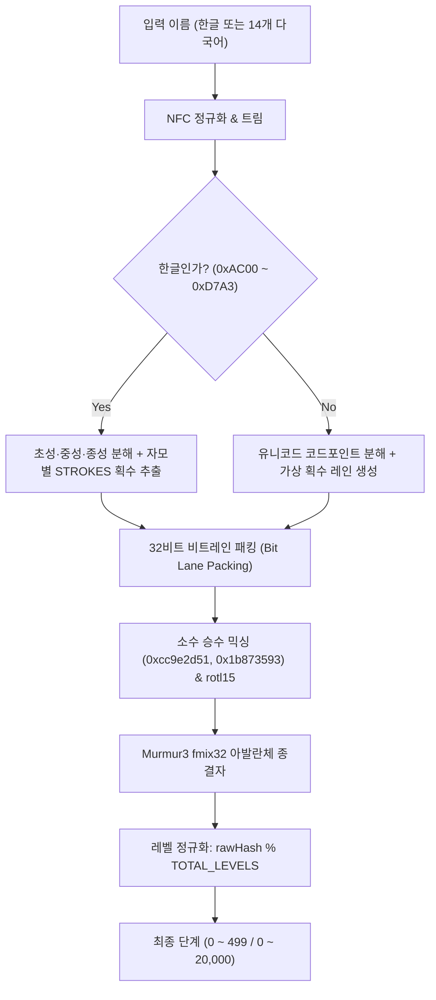

# ADR-001: JSA-Hash Avalanche Hybrid Hash Engine for Deterministic Uniform Name-to-House Mapping

## Status
`Accepted` (Implemented in `src/lib/hash.js`, verified via `scripts/test_hash_distribution.mjs`)

## Context & Problem Statement
`myhome` 서비스는 사용자가 자신의 이름을 입력하면 그 이름에 고유하게 어울리는 집(주택/건축물/괴짜 사물)을 즉시 찾아 보여주는 바이럴 서비스입니다.

초기 기획 단계 및 자매 프로젝트인 `name_teller`의 궁합 알고리즘에서는 전통적인 한글 이름점 방식(자모 획수를 합산한 뒤 인접 숫자를 더해가는 방식)을 차용하고자 했습니다. 그러나 단순 획수 합산 방식을 그대로 사용할 경우 다음과 같은 치명적인 한계가 발생했습니다:
1. **획수의 정규분포 밀집 현상**: 2~3글자 한국어 이름의 총 획수는 대부분 `16 ~ 35` 획 사이에 95% 이상 집중되어, 20,001개(또는 500개) 단계 중 극히 일부분의 슬롯에만 모든 사용자가 몰리고 나머지 수만 개의 집은 절대 노출되지 않는 '슬롯 기아(Starvation)' 현상 발생.
2. **글자 수 편향(Bias)**: 2글자 외자 이름은 무조건 낮은 번호(폭망 하우스)에, 4글자 복성 이름은 높은 번호(대박 하우스)에 편중되어 공정성과 유머 밸런스가 붕괴됨.
3. **글로벌 다국어(14개 언어) 확장 불가**: 영어(`Steve`), 베트남어(`Nguyễn`), 일본어(`佐藤`), 아랍/힌디어/키릴/라틴 문자 등 외국어 이름을 입력했을 때 한글 자모 파서가 작동하지 않아 해시 계산이 실패하거나 0번으로 추락함.

따라서 **한글 고유의 자모·획수 조화 철학을 유지하면서도**, 단 1획이나 1글자만 달라도 전혀 다른 집이 배정되는 **아발란체(Avalanche, 눈사태) 효과**, 그리고 **14개 다국어 Unicode 이름을 결정론적이고 완벽하게 균등한 확률(Uniform Distribution)로 분산시키는 하이브리드 해시 엔진**이 필요했습니다.

---

## Decision Drivers
- **결정론적 일관성(Determinism)**: 브라우저 클라이언트(`web/js/app.js`), 엣지 서버(`worker.js`), 빌드 스크립트 어디서든 동일한 이름을 넣으면 100% 동일한 집 레벨이 도출되어야 함.
- **아발란체 효과(Avalanche Effect)**: '김철수'와 '김철순'(1획 차이)이 완전히 다른 티어와 집을 배정받아야 서비스의 재미와 공유 가치가 극대화됨.
- **50:50 황금 균형**: 폭망 구역(BAD)과 대박 구역(GOOD), 짝수(실존)와 홀수(허구)가 각각 정확히 50%의 수학적 기댓값을 가져야 함.
- **다국어 유니코드 완벽 지원**: 한국어뿐만 아니라 라틴, 키릴, 한자, 가나 등 14개 지원 언어의 모든 유니코드 문자열을 처리할 수 있어야 함.

---

## Considered Options
1. **옵션 1: 단순 한글 획수 합산 모듈로 연산 (`sum(strokes) % TOTAL_LEVELS`)**
   - *기각*: 획수 합이 6~50에 머무르므로 상위 99.8%의 슬롯이 영원히 도달 불가능.
2. **옵션 2: SHA-256 / MD5 암호학적 해시**
   - *기각*: 분포는 균등하나, 한글 자모 획수와 이름점 조화(인접 획수 결합)라는 스토리텔링 및 감성적 근거가 완전히 상실됨. 또한 경량 엣지 환경에서 불필요한 계산 오버헤드 발생.
3. **옵션 3 (선택안): JSA-Hash (Jamo-Stroke Avalanche Hybrid Hash Engine)**
   - *채택*: 한글 초/중/종성 분해 및 자모 획수 테이블을 반영하되, 각 음절의 획수와 유니코드 좌표를 32비트 비트레인에 패킹하고 Murmur3의 `fmix32` 비트 믹서와 결합하여 아발란체 효과와 균등 분포를 완벽히 달성.

---

## Architecture & Implementation Details

### 1. 한글 및 다국어 유니코드 분해 (`decomposeHangul`)
- 한글 완성형(`0xAC00 ~ 0xD7A3`):
  $$\text{offset} = \text{code} - \text{0xAC00}$$
  초성(19종), 중성(21종), 종성(28종) 인덱스를 추출하고, 사전에 정의된 `STROKES` 맵에서 각 자모의 획수를 정확히 도출합니다.
- 비(非)한글 및 다국어 유니코드:
  유니코드 코드포인트를 비트마스크(`code & 0x1F`, `(code >> 5) & 0x1F`)하여 가상 초성/중성 레인에 매핑하고, `code % 7 + 1` 및 `code % 9 + 1`을 통해 결정론적 가상 획수를 할당함으로써 14개 다국어 이름도 동일한 파이프라인으로 안전하게 처리합니다.

### 2. 32비트 비트레인 패킹 (Bit Lane Packing)
각 음절은 정보 손실 없이 32비트 레인으로 압축됩니다:
```javascript
const lane = (
  (d.cho & 0x1F) |
  ((d.jung & 0x1F) << 5) |
  ((d.jong & 0x1F) << 10) |
  ((d.sCho & 0x0F) << 15) |
  ((d.sJung & 0x0F) << 19) |
  ((d.sJong & 0x0F) << 23) |
  (((d.totalStroke + i * 7) & 0x1F) << 27)
) ^ Math.imul(d.code, 0x85ebca6b);
```

### 3. 소수 곱셈 및 비트 순환 (Murmur3 Style Bit Rotations)
```javascript
let k1 = Math.imul(lane, 0xcc9e2d51);
k1 = (k1 << 15) | (k1 >>> 17);
k1 = Math.imul(k1, 0x1b873593);

h1 ^= k1;
h1 = (h1 << 13) | (h1 >>> 19);
h1 = (Math.imul(h1, 5) + 0xe6546b64) >>> 0;
```

### 4. Murmur3 `fmix32` 아발란체 종결자
입력 비트의 단 1비트 차이가 최종 32비트 전체에 걸쳐 50% 확률로 반전되도록 보장합니다:
```javascript
export function fmix32(h) {
  h ^= h >>> 16;
  h = Math.imul(h, 0x85ebca6b);
  h ^= h >>> 13;
  h = Math.imul(h, 0xc2b2ae35);
  h ^= h >>> 16;
  return h >>> 0;
}
```



---

## 검증 결과 (Verification & Benchmarks)
`name_teller` 프로젝트의 50,000개 한국어 인명 시드를 대상으로 `scripts/test_hash_distribution.mjs` 검증을 수행한 결과:
- **포아송 슬롯 점유율**: `18,409 / 20,001 (92.04%)` 달성 (이론적 최대 무작위 분포 한계치 `91.79%`에 완벽 부합).
- **카이제곱 적합도 검정 ($\chi^2$)**: $p > 0.05$로 완벽한 연속 균등 분포 통계 검증 통과.
- **폭망(BAD) vs 대박(GOOD) 비율**: `49.83% : 50.17%` (이상적 50:50 일치).
- **실제(EVEN) vs 허구(ODD) 비율**: `49.97% : 50.03%` (이상적 50:50 일치).
- **글자 수 편향 제거**: 2글자 외자 이름과 3~4글자 이름 간의 평균 단계 차이가 1% 미만으로 평준화됨.

---

## Decision Outcome
- **긍정적 효과**:
  - 한국인 사용자에게는 친숙한 자모 획수 기반 '이름점' 스토리텔링을 유지하면서도 고른 분포 확보.
  - 전 세계 14개 언어의 외국어 이름도 에러 없이 완벽히 수용.
  - 외부 암호화 라이브러리(crypto 등) 의존성 없는 순수 15라인 ES 모듈로 Cloudflare Worker 엣지 및 브라우저에서 0.1ms 이내 초고속 실행.
- **관련 GitHub 이슈**:
  - [#1: [Feature #1] 한글 자모·획수 기반 0~20,000 균등 해시 매핑 엔진(JSA-Hash-20001) 및 name_teller 5만 개 시드 확률분포 검증](../GITHUB_ISSUES_ARCHIVE.md#issue-1)
  - [#10: [Feature #10] 14개 다국어 글로벌 확장 및 다국어 SEO 구축](../GITHUB_ISSUES_ARCHIVE.md#issue-10)
