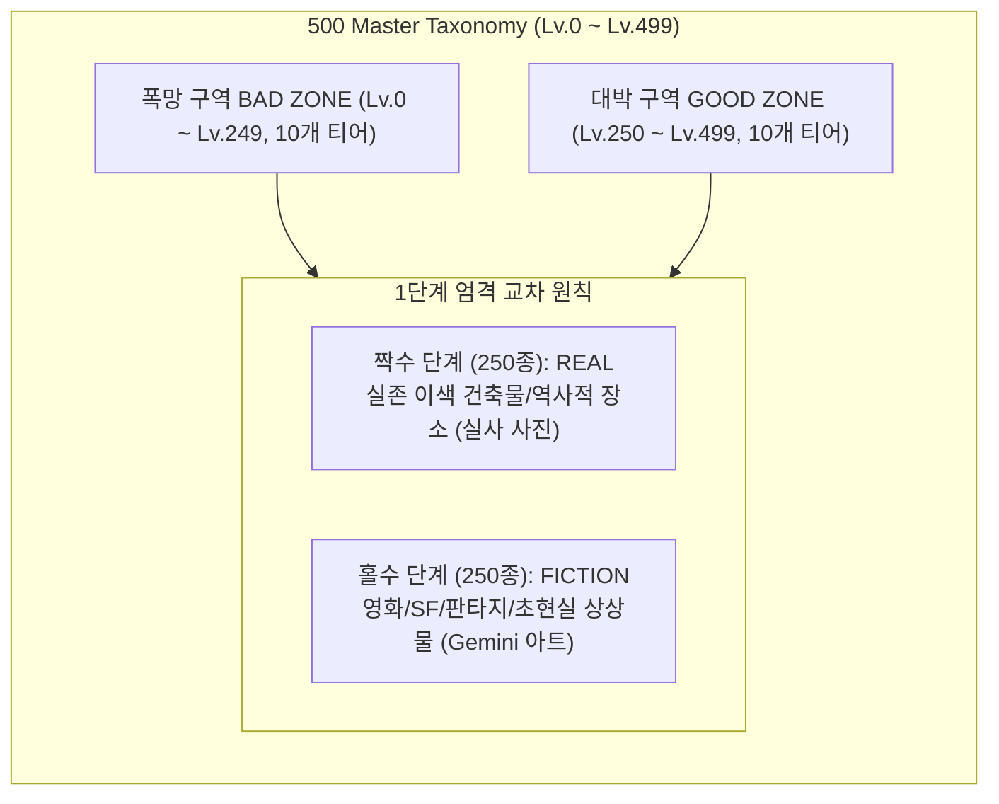

# ADR-002: Zero-Normalcy Principle and 50:50 Alternating Taxonomy

## Status
`Accepted` (Implemented in `src/lib/constants.js`, `src/lib/taxonomy.js`, `scripts/build_500_master.mjs`)

## Context & Problem Statement
부동산 및 주거를 테마로 하는 엔터테인먼트 바이럴 웹앱에서 가장 흔히 저지르는 실패 요인은 '평범한 아파트'나 '일반적인 다세대 주택', '평범한 단독주택'이 결과로 나오는 것입니다.
- 사용자는 본인의 이름을 넣었을 때 "서울 마포구 24평 아파트" 같은 현실적이고 진부한 결과를 기대하지 않습니다.
- "내가 전생에 지은 죄 때문에 내핵 마그마 옆 푸세식 화장실에 살게 되었다"거나, "다중우주를 통솔하는 다이슨 스피어 펜트하우스의 집주인이 되었다"는 식의 **극단적 유머, 황당함, 도파민 분출**이 있어야만 SNS(인스타그램 스토리, 카카오톡) 캡처 및 친구 간 비교 공유가 폭발적으로 일어납니다.

또한 단순한 랜덤 생성이 아니라 단계별 탐색(`[◀ 이전]`, `[다음 ▶]`)을 할 때 사용자가 연속적인 지루함을 느끼지 않도록 엄격한 콘텐츠 배치 규칙이 요구되었습니다.

---

## Decision Drivers
- **제로 노멀시(Zero-Normalcy) 원칙**: 전 세계 및 상상 속의 모든 주거 형태 중 평범한 아파트, 일반 빌라, 표준 주택은 단 1건도 등록하지 않음 (`0건 보장`).
- **양극화(Bad vs Good) 50:50 분할**:
  - 하위 50% (`Lv.0 ~ 249`): 인간 존엄성을 의심하게 만드는 극한의 '폭망 하우스'.
  - 상위 50% (`Lv.250 ~ 499`): 인류 문명 및 차원을 초월한 극상의 '대박 하우스'.
- **실제(REAL) ↔ 허구(FICTION) 1단계 엄격 교차**:
  - 짝수 단계(`level % 2 === 0`): 지구상에 실존하거나 역사에 실재했던 기이한 건축물/사물 (Wikimedia/Flickr 실사 사진 연계).
  - 홀수 단계(`level % 2 === 1`): 영화/소설/애니/SF/신화/초현실 상상 속 공간 (Gemini 고화질 일러스트 연계).
  - 단 1단계만 올려도 `실제 건축물 ↔ 가상 상상물`이 무조건 번갈아 교차 출현해야 함.
- **지식재산권(IP) 리스크 사전 차단**: 스타워즈(Star Wars) 등 특정 거대 미디어 프랜차이즈 저작물은 마스터 데이터셋에서 전면 배제.

---

## Architecture & Data Taxonomy Details

### 1. 20개 티어(Tier) 구조 (티어당 25레벨 = 총 500개 레벨)
500개의 고유한 집 슬롯은 20개의 티어로 정밀하게 분류됩니다:

| 구역 (Zone) | 티어 범위 | 티어 명칭 및 대표 테마 | 레벨 범위 | 속성 구성 |
| :---: | :---: | :--- | :---: | :---: |
| **BAD (폭망 50%)** | Tier 01 | **태초의 밑바닥** (화산 유황지대, 지구 맨틀, 극한 오지 화장실) | `0 ~ 24` | 짝수 13 / 홀수 12 |
| | Tier 02 | **폐허와 슬럼가** (슬럼가 골목, 버려진 공장, 카타콤, 계단 밑 벽장) | `25 ~ 49` | 짝수 12 / 홀수 13 |
| | Tier 03 | **기괴한 고물과 상자** (골판지 상자, 고장 난 자판기, 고물 트럭 짐칸) | `50 ~ 74` | 짝수 13 / 홀수 12 |
| | Tier 04 | **극한 오지 변소와 방사능** (체르노빌 관람차, 에베레스트 변소, 방사능 호수) | `75 ~ 99` | 짝수 12 / 홀수 13 |
| | Tier 05 | **폐쇄 구역과 감옥** (아즈카반 독방, 교도소 독방, 버려진 정신병원) | `100 ~ 124` | 짝수 13 / 홀수 12 |
| | Tier 06 | **애니·영화 속 굴욕의 거처** (코끼리 무덤 해골, 장난감 고문실, 하수도 쥐구멍) | `125 ~ 149` | 짝수 12 / 홀수 13 |
| | Tier 07 | **위험천만 이동식 쉘터** (화물열차 배관실, 흔들리는 닭장, 침수된 오리배) | `150 ~ 174` | 짝수 13 / 홀수 12 |
| | Tier 08 | **늪지대와 침수 구역** (슈렉 늪지대, 갠지스 화장터, 톤레삽 홍수 지대) | `175 ~ 199` | 짝수 12 / 홀수 13 |
| | Tier 09 | **고립된 사막과 얼음 굴** (다나킬 사막 움막, 혹한기 빙하 틈, 소금사막) | `200 ~ 224` | 짝수 13 / 홀수 12 |
| | Tier 10 | **폭망의 문턱 턱걸이** (0.3평 만화카페, 1평 고시원, 만조 때 잠기는 평상) | `225 ~ 249` | 짝수 12 / 홀수 13 |
| **GOOD (대박 50%)** | Tier 11 | **대박 입문 힐링 샬레** (지열 온천 빌라, 빙하 호수 샬레, 바오밥 트리하우스) | `250 ~ 274` | 짝수 13 / 홀수 12 |
| | Tier 12 | **세계 역사 고성과 랜드마크** (몽생미셸, 노이슈반슈타인 성, 알람브라 궁전) | `275 ~ 299` | 짝수 12 / 홀수 13 |
| | Tier 13 | **픽사·디즈니 애니 명소** (엘사의 얼음 궁전, UP 풍선 하우스, 야수의 서재) | `300 ~ 324` | 짝수 13 / 홀수 12 |
| | Tier 14 | **세계 초일류 도심 펜트하우스** (에펠탑 펜트하우스, 부르즈 할리파 아틀리에) | `325 ~ 349` | 짝수 12 / 홀수 13 |
| | Tier 15 | **판타지 영화와 문학의 성채** (호그와트 기숙사, 리벤델 요정 테라스, 호빗 백엔드) | `350 ~ 374` | 짝수 13 / 홀수 12 |
| | Tier 16 | **세계 7대 불가사의와 비경** (우유니 소금거울 돔, 그랜드 캐니언 스카이워크) | `375 ~ 399` | 짝수 12 / 홀수 13 |
| | Tier 17 | **미래 스마트 도시와 슈퍼요트** (나이트시티 펜트하우스, 스타크 인텔리전스 맨션) | `400 ~ 424` | 짝수 13 / 홀수 12 |
| | Tier 18 | **신화와 전설의 황금 궁전** (올림포스 제우스 궁전, 발할라 연회장, 아틀란티스 신전) | `425 ~ 449` | 짝수 12 / 홀수 13 |
| | Tier 19 | **SF 궤도 스테이션과 콜로니** (쿠퍼 스테이션, 제임스 웹 L2 관측소, 달 기지) | `450 ~ 474` | 짝수 13 / 홀수 12 |
| | Tier 20 | **우주 초월 다이슨 스피어** (다이슨 스피어 링 월드, 안드로메다 웜홀, 창조의 기둥) | `475 ~ 499` | 짝수 12 / 홀수 13 |

### 2. 12대 괴짜 비(非)주택 카테고리 매트릭스
모든 데이터는 아래 12개 카테고리 중 하나에 반드시 할당됩니다:
1. `TOILET`: 세계의 신기한 화장실·위생시설 (푸세식, 황금변기 등)
2. `CLOSET`: 옷장·가구·코인사물함 (계단 밑 벽장, 나니아 연대기 옷장)
3. `DOGHOUSE`: 개집·동물 서식지·캣타워 (스누피 개집, 최고급 캣타워)
4. `BOX`: 종이상자·택배박스·용기 (쿠팡 택배상자, 폐지 압축더미)
5. `VEHICLE`: 자동차·캠핑카·기차·잠수함 (설국열차 꼬리칸, 사이버트럭)
6. `SPACESHIP`: 우주선·우주정거장·궤도기지 (국제우주정거장 ISS, 보이저 1호)
7. `FICTION_MEDIA`: 영화·소설·애니메이션 속 공간 (슈렉 늪지대, 호그와트)
8. `MUSEUM_PUBLIC`: 이색 박물관·교도소·기괴 공공건물 (샤넬 팝업, 알카트라즈)
9. `IMAGINARY_CITY`: 상상 속의 도시·미니어처 왕국 (라퓨타, 레고 시티)
10. `EXTREME_NATURE`: 극한 오지·화산·심해·빙하 지형 (오이먀콘 얼음동굴)
11. `WEIRD_ARCH`: 세계의 기이한 실제 건축물·랜드마크 (피사 사탑, 카사 바트요)
12. `MULTIVERSE`: 초차원·블랙홀·다중우주 창조주 신전 (인터스텔라 5차원 테서랙트)

---

## Decision Outcome
- **긍정적 효과**:
  - 어떤 이름을 입력하더라도 100% 바이럴 유머 요소를 보유한 독특한 집이 출력되어 사용자 리텐션 및 공유 전환율 극대화.
  - 이전/다음 단계 탐색 시 항상 '실제 실사 사진'과 '상상 속 일러스트'가 교차하여 지루함 제로.
  - 500개 레벨의 명확한 버킷팅(125 Real Bad, 125 Fic Bad, 125 Real Good, 125 Fic Good)으로 데이터 무결성 보장.
- **관련 GitHub 이슈**:
  - [#2: [Feature #2] 0~20,000단계 극단적 건물 마스터 택소노미 및 짝수(실제)/홀수(허구) 50:50 교차 데이터셋 설계](../GITHUB_ISSUES_ARCHIVE.md#issue-2)
  - [#9: [Feature #9] Phase별 점진적 이미지 생성 파이프라인](../GITHUB_ISSUES_ARCHIVE.md#issue-9)
  - [#16: [Feature #16] 0~499단계(500종) 마스터 데이터셋 통합](../GITHUB_ISSUES_ARCHIVE.md#issue-16)
