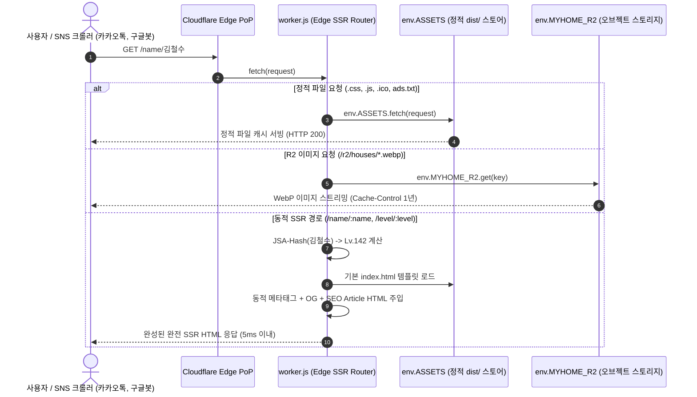

# ADR-003: Zero-File-Explosion Architecture using Cloudflare Workers & Static Assets Edge SSR

## Status
`Accepted` (Implemented in `wrangler.toml`, `worker.js`, `scripts/generate_static_site.mjs`)

## Context & Problem Statement
`myhome` 프로젝트는 **50,000개의 다국어 대표 인명 URL**(`https://myhome.tellmyname.app/name/{이름}`)과 단계별 URL(`https://myhome.tellmyname.app/level/{N}`)을 제공하여 검색엔진(구글, 네이버, 얀덱스 등) 및 소셜 미디어 크롤러(카카오톡, 인스타그램, 트위터)에 완벽한 SEO 및 OG 미리보기를 응답해야 합니다.

전통적인 정적 사이트 생성(SSG) 방식으로 이 요구사항을 해결하려 할 경우 다음과 같은 심각한 아키텍처 결함이 발생합니다:
1. **정적 파일 폭발(File Explosion)**: 50,000개 이상의 물리적 `.html` 파일을 빌드할 경우, 빌드 시간이 수십 분으로 증가하고 디스크 용량 수 기가바이트(GB)를 소모함.
2. **호스팅 플랫폼 파일 개수 제한 위반**: Cloudflare Pages의 단일 배포 파일 개수 제한(20,000개)을 2.5배 이상 초과하여 배포 자체가 불가능함.
3. **순수 SPA(Single Page Application)의 SEO 한계**: 빈 껍데기 HTML만 호스팅하고 클라이언트 자바스크립트로 렌더링할 경우, 자바스크립트를 실행하지 않는 카카오톡 스크랩 봇이나 네이버 Yeti 크롤러에서 제목과 이미지가 노출되지 않아 바이럴 공유 효과가 전무해짐.

---

## Decision Drivers
- **무파일 증식(Zero-File-Explosion)**: `dist/` 정적 디렉터리 내 물리적 파일 수를 **50개 미만**으로 엄격히 유지.
- **완벽한 크롤러 호환성 (Edge Dynamic SSR)**: 자바스크립트를 실행하지 않는 어떤 봇이나 크롤러가 접근하더라도 100% 완전한 메타태그, OG 태그, Schema.org 구조화 데이터, 검색용 본문 마크업(`<article id="seo-house-card">`)을 엣지에서 즉시 주입하여 반환.
- **최신 Workers & Assets 단일 파이프라인**: 레거시 Cloudflare Pages 대신 최신 Cloudflare Workers with Static Assets (`[assets]` 바인딩)를 채택하여 `npx wrangler deploy` 단 한 번으로 엣지 코드와 정적 자산을 원클릭 배포.
- **초저지연(Sub-10ms) 응답 속도**: 전 세계 300개 이상의 Cloudflare 엣지 PoP에서 서버리스 함수 구동 지연 없이 즉각 응답.

---

## Considered Options
1. **옵션 1: Cloudflare Pages SSG (50,000개 HTML 사전 빌드)**
   - *기각*: 파일 수 제한(최대 20,000개) 초과로 배포 실패. 빌드 시간 과다.
2. **옵션 2: 전통적 Node.js Express / Next.js 전용 인스턴스 호스팅**
   - *기각*: 상시 구동 서버 유지 비용 발생, 글로벌 엣지 다지역 배포 복잡성, 트래픽 폭증 시 콜드 스타트 및 스케일링 지연 발생.
3. **옵션 3 (선택안): Cloudflare Workers with Static Assets + Edge Dynamic SSR (`worker.js`)**
   - *채택*: `dist/`에는 오직 핵심 정적 자산(CSS, JS, 사이트맵, ads.txt 등 총 20개 내외)만 보관하고, 모든 동적 경로(`/name/:name`, `/level/:level`)는 `worker.js`가 가로채 엣지 메모리 상에서 실시간으로 HTML을 조립(SSR)하여 반환.

---

## Architecture & Implementation Details

### 1. `wrangler.toml`의 현대적 Workers & Assets 구성
```toml
name = "myhome"
main = "worker.js"
compatibility_date = "2026-10-01"

[assets]
directory = "./dist"
binding = "ASSETS"
not_found_handling = "single-page-application"
html_handling = "auto-trailing-slash"
run_worker_first = true

[[r2_buckets]]
binding = "MYHOME_R2"
bucket_name = "myhome-houses-r2"
```
- `run_worker_first = true`: 모든 HTTP 요청이 엣지 Worker 핸들러를 먼저 통과하도록 강제.
- `binding = "ASSETS"`: 정적 에셋(JS 번들, 스타일시트, 파비콘 등)은 `env.ASSETS.fetch(request)`를 통해 Cloudflare의 글로벌 정적 CDN 캐시에서 직접 서빙.

### 2. 엣지 동적 SSR 라우터 (`worker.js`)
사용자 또는 크롤러가 `/name/{이름}` 또는 `/level/{레벨}`을 요청하면:
1. 경로 파싱 및 디코딩.
2. 초경량 `JSA-Hash` 엔진으로 집 단계(`0 ~ 499`) 도출 (0.1ms).
3. 메모리 내 마스터 데이터셋에서 집 스펙(`title`, `builtYear`, `estimatedValue`, `specialFeature`) 인덱싱.
4. `dist/index.html` 템플릿의 `<head>`와 `<section id="card-root">`에 실시간 정적 HTML 스트링 주입:
   - `<title>`: `"{이름}님에게 어울리는 집 (Lv.X) — {집이름} | 나에게 어울리는 집"`
   - `<meta property="og:image">`: `https://myhome.tellmyname.app/r2/houses/{padded}.webp`
   - `<link rel="canonical">` 및 `hreflang` 태그
   - `Schema.org` JSON-LD (`Residence`, `WebPage`, `FAQPage`)
   - 크롤러용 본문 카드: `<article id="seo-house-card">`



---

## Decision Outcome
- **긍정적 효과**:
  - `dist/` 내 물리적 파일 수 20여 개로 유지 (Cloudflare 정적 제한의 0.1% 미만).
  - 50,000개 이상의 이름 URL과 500개 레벨 URL이 무한히 확장 가능하면서도 빌드 시간 3초 이내 유지.
  - 카카오톡, 페이스북, 슬랙, 인스타그램 등 모든 외부 봇에서 풍부한 OG 카드와 썸네일 즉시 출력.
  - 배포가 `npm run build && npx wrangler deploy` 단 한 줄로 완료됨.
- **관련 GitHub 이슈**:
  - [#5: [Feature #5] 파일 개수를 늘리지 않는 Cloudflare 정적 호스팅 및 엣지 동적 SSR 라우터 구현](../GITHUB_ISSUES_ARCHIVE.md#issue-5)
  - [#14: [Feature #14] Cloudflare Workers & Assets 신규 정적 호스팅 배포 파이프라인 및 wrangler deploy 가이드](../GITHUB_ISSUES_ARCHIVE.md#issue-14)
