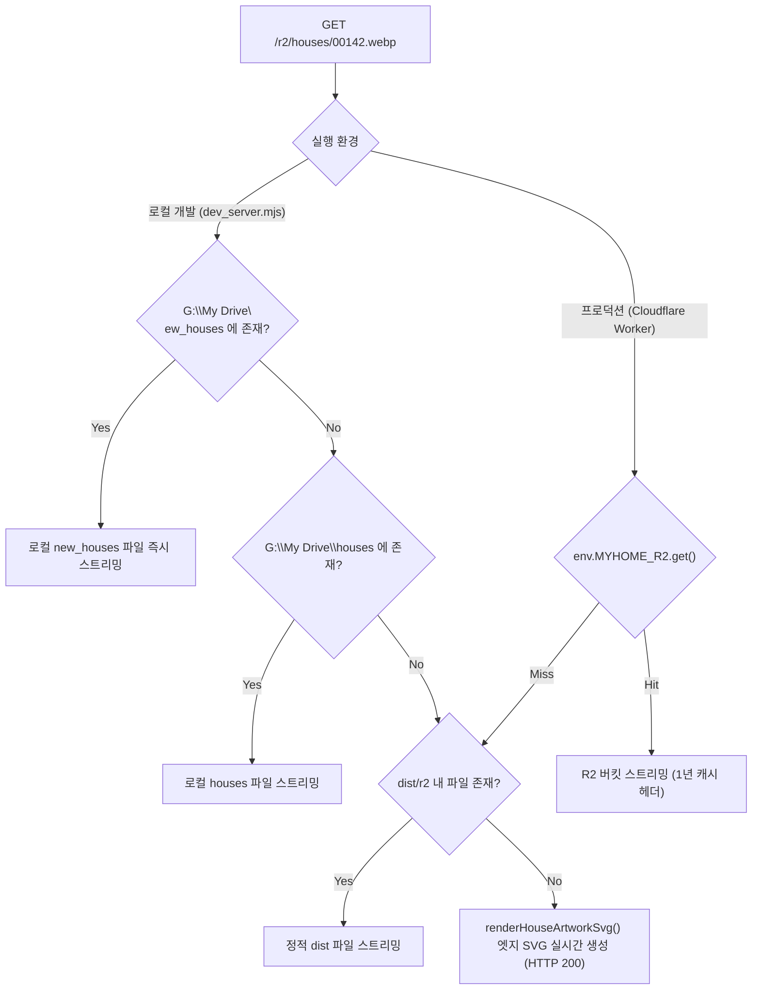

# ADR-004: Same-Origin Cloudflare R2 Storage and Local G-Drive Hybrid Image Serving

## Status
`Accepted` (Implemented in `src/lib/constants.js`, `worker.js`, `scripts/dev_server.mjs`, `scripts/upload_r2_images.mjs`)

## Context & Problem Statement
`myhome` 프로젝트는 500종(최종 20,001종)에 달하는 고해상도 집 이미지(실사 사진 및 Gemini AI 생성 일러스트)를 서빙해야 합니다.

이미지 자산을 관리하고 배포할 때 다음과 같은 문제점들이 존재했습니다:
1. **깃 저장소(Git) 및 정적 배포 번들 비대화**: 고용량 PNG/WebP 이미지를 저장소에 포함할 경우 Git clone 속도가 심각하게 저하되고 Cloudflare Workers 정적 에셋 업로드 한도(자산당 25MB, 총합 용량 한도)에 도달할 위험이 큼.
2. **별도 CDN 서브도메인의 오버헤드**: 이미지를 외부 스토리지 도메인(예: `s3.amazonaws.com` 등)으로 직접 노출할 경우, 모바일 브라우저에서 추가적인 DNS 룩업, TLS 핸드셰이크 지연 및 CORS 이슈가 발생하며, 인스타그램 스토리 합성 시 캔버스 Tainted Canvas(CORS 에러) 문제가 발생함.
3. **로컬 개발과 생성 파이프라인의 불일치**: 로컬 데스크톱(`scripts/dev_server.mjs`) 환경에서 이미지를 수집하고 생성하는 경로는 구글 드라이브 동기화 폴더(`G:\My Drive\new_houses` 및 `G:\My Drive\houses`)인데, R2 버킷에 업로드하기 전까지는 웹 화면에서 이미지를 확인할 수 없는 개발 병목 발생.
4. **미생성 슬롯의 깨진 이미지(Broken Image) 노출 방지**: 신규 단계 이미지가 생성 중이거나 네트워크 일시 장애 시 X박스(깨진 아이콘) 대신 우아한 대체 화면이 제공되어야 함.

---

## Decision Drivers
- **동일 오리진(Same-Origin) 규약**: 이미지 URL은 외부 도메인이 아닌 무조건 `https://myhome.tellmyname.app/r2/houses/{padded}.webp`의 동일 오리진 경로로 통일하여 CORS 및 DNS 오버헤드를 0으로 유지.
- **로컬 우선(Local-First) 스트리밍**: 로컬 개발 서버 구동 시 `G:\My Drive\new_houses`에 존재하는 파일을 최우선 스트리밍하여 생성 즉시 브라우저에서 실시간 검증 가능하도록 구현.
- **R2 글로벌 제로 대역폭(Zero Egress) 비용**: 프로덕션에서는 Cloudflare R2 버킷과 Worker를 직접 바인딩하여 대역폭 전송료(Egress Fee) $0 달성 및 1년 불변 캐시(`max-age=31536000, immutable`) 적용.
- **무파괴 엣지 SVG 동적 폴백**: 물리적 파일이 아직 존재하지 않는 경우 절대로 404를 반환하지 않고, 엣지에서 절차적 벡터 아트워크 SVG를 생성하여 즉시 대체 서빙.

---

## Considered Options
1. **옵션 1: AWS S3 + CloudFront 서브도메인 분리 (`img.tellmyname.app`)**
   - *기각*: 도메인 분리로 인한 모바일 네트워크 핸드셰이크 지연 및 아웃바운드 데이터 전송료(Egress Fee) 누적.
2. **옵션 2: GitHub Releases 또는 무료 외부 이미지 호스팅 사용**
   - *기각*: 핫링크 방지 제한, 속도 불안정, 브라우저 Canvas 렌더링 시 CORS 오염 발생.
3. **옵션 3 (선택안): Cloudflare R2 버킷 바인딩 + 로컬 G-Drive 하이브리드 파이프라인**
   - *채택*: 프로덕션은 `env.MYHOME_R2` 바인딩을 통한 내부 버퍼 스트리밍, 로컬 개발은 `G:\My Drive\new_houses` 다이렉트 파일 시스템 스트리밍, 실패 시 엣지 SVG 렌더러로 이어지는 5단계 계층형 폴백 체계 구축.

---

## Architecture & Implementation Details

### 1. 동일 오리진 이미지 라우팅 규약
모든 클라이언트 UI와 메타데이터는 오직 아래 헬퍼를 통해서만 이미지 URL을 획득합니다 (`src/lib/constants.js`):
```javascript
export function getHouseImageUrl(level, withOrigin = false) {
  const clamped = Math.max(MIN_LEVEL, Math.min(MAX_LEVEL, Math.floor(Number(level) || 0)));
  const padded = String(clamped).padStart(5, '0');
  const relPath = `/r2/houses/${padded}.webp`;
  return withOrigin ? `${SITE_ORIGIN}${relPath}` : relPath;
}
```

### 2. 5단계 계층형 서빙 및 폴백 우선순위
`worker.js`와 `scripts/dev_server.mjs`는 이미지 요청 수신 시 다음 순서로 리소스를 탐색합니다:

| 순위 | 탐색 경로 / 대상 | 환경 | 설명 |
| :---: | :--- | :---: | :--- |
| **1순위** | `G:\My Drive\new_houses\{padded}.png` / `.webp` | 로컬 개발 | 최신 500 마스터 수집/생성 고화질 이미지 |
| **2순위** | `G:\My Drive\houses\{padded}.png` / `.webp` | 로컬 개발 | 기존 1단계 아카이브 이미지 |
| **3순위** | `dist/r2/houses/{padded}.*` | 로컬/공통 | 로컬 빌드 정적 캐시 파일 |
| **4순위** | `env.MYHOME_R2.get("houses/{padded}.webp")` | 프로덕션 | Cloudflare R2 글로벌 오브젝트 스토리지 |
| **5순위** | `renderHouseArtworkSvg(house)` | 공통 (최종) | 엣지 동적 생성 절차적 SVG 플레이스홀더 (404 없음) |



### 3. 메타데이터 JSON 동반 서빙 (`{padded}.json`)
실사 사진(짝수 단계)의 경우 위키미디어 공용/Flickr의 저작자, 원본 출처, 라이선스(CC BY, Public Domain 등) 정보가 담긴 JSON 파일이 `G:\My Drive\new_houses\{padded}.json` 형태로 이미지와 1:1로 함께 관리되며, 로컬 및 배포 파이프라인에서 함께 제공됩니다.

---

## Decision Outcome
- **긍정적 효과**:
  - 완벽한 동일 오리진(`https://myhome.tellmyname.app/...`)으로 브라우저 Canvas 렌더링 시 CORS Tainted 이슈 원천 차단.
  - 개발자가 로컬에서 이미지를 생성하거나 수집하는 즉시 별도의 업로드 절차 없이 `http://localhost:8787`에서 즉각 육안 검증 가능.
  - 프로덕션 배포 시 Cloudflare R2의 무제한 용량과 전 세계 엣지 캐시를 활용하여 서버 부하 제로 달성.
  - 파일 미존재 시에도 세련된 엣지 SVG 카드가 노출되어 사용자가 깨진 화면을 보지 않음.
- **관련 GitHub 이슈**:
  - [#4: [Feature #4] Cloudflare R2 오브젝트 스토리지 구축 및 이미지/메타데이터 초경량 청크 서빙 연동](../GITHUB_ISSUES_ARCHIVE.md#issue-4)
  - [#16: [Feature #16] 0~499단계 마스터 데이터셋 통합 및 G:\My Drive\new_houses 로컬 이미지 즉시 서빙 연동](../GITHUB_ISSUES_ARCHIVE.md#issue-16)
