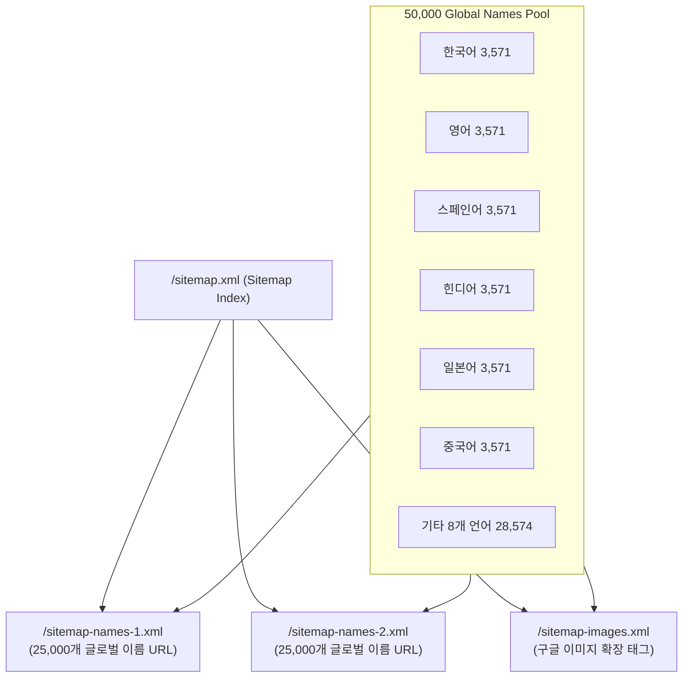

# ADR-005: 14-Language Localization, 50,000 Global Names Dataset, and Programmatic Image SEO

## Status
`Accepted` (Implemented in `src/lib/i18n.js`, `scripts/build_seed_50k_names.mjs`, `scripts/generate_static_site.mjs`, `worker.js`)

## Context & Problem Statement
`myhome` 프로젝트는 국내(한국어) 바이럴에 머무르지 않고 전 세계적인 유입과 검색 노출을 지향합니다.
인터넷 인구가 가장 많은 상위 14개 언어권의 사용자들에게 각자의 모국어로 자연스럽게 다가가기 위해 다국어 번역과 국제화(i18n) 아키텍처가 필수적이었습니다.

동시에 구글 검색 유입의 막대한 비중을 차지하는 **'구글 이미지 검색(Google Image Search)'** 트래픽을 선점할 필요가 있었습니다. 많은 글로벌 사용자들이 특정 인물이나 본인의 이름과 관련하여 `"{name} house recommendation"`, `"{name} house image"`, `"what house suits {name}"` 등의 키워드로 이미지를 검색합니다.

이를 위해서는:
1. 14개 언어권에 걸쳐 고르게 분포된 **50,000개의 글로벌 유명 인명 데이터셋**이 필요했습니다.
2. 구글 및 글로벌 검색봇이 50,000개 URL을 효과적으로 크롤링할 수 있는 **분할 사이트맵(`sitemap-names-*.xml`)**과 **이미지 전용 사이트맵(`sitemap-images.xml`)**이 요구되었습니다.
3. 엣지 SSR에서 각 언어별로 최적화된 `<link rel="alternate" hreflang="...">` 교차 태그 및 `Schema.org/ImageObject` 구조화 데이터가 자동으로 렌더링되어야 했습니다.

---

## Decision Drivers
- **14개 주요 글로벌 언어 지원**:
  `ko`(한국어), `en`(영어), `hi`(힌디어), `vi`(베트남어), `fr`(프랑스어), `pt`(포르투갈어), `es`(스페인어), `id`(인도네시아어), `ru`(러시아어), `de`(독일어), `it`(이탈리아어), `ja`(일본어), `zh`(중국어 간체), `ms`(말레이어).
- **글로벌 인명 50,000개 균등 분배**: 14개 언어권별로 약 3,571개씩 균등하게 대표 유명인/인기 인명을 수집하여 특정 국가로의 편중 배제.
- **구글 표준 사이트맵 규격 준수**: 단일 사이트맵 파일당 최대 50,000개(권장 25,000개 단위) 제한을 지키기 위해 `sitemap-names-1.xml`, `sitemap-names-2.xml`, `sitemap-images.xml`로 분할하고 루트 `sitemap.xml` 인덱스로 묶음.
- **프로그래매틱 이미지 SEO(Image SEO)**: 검색 쿼리에 대응하는 풍부한 이미지 메타데이터(`<image:loc>`, `<image:caption>`, `<image:title>`, ``) 동적 주입.

---

## Considered Options
1. **옵션 1: 클라이언트 측 번역 라이브러리(i18next 등)만 적용하고 한국어 URL 단일화**
   - *기각*: 해외 검색엔진(Google, Bing, Yandex 등)이 다른 언어 버전의 존재를 인지할 수 없어 글로벌 SEO 효과 전무.
2. **옵션 2: 14개 언어별로 독립적인 도메인이나 14배의 정적 사이트 분리 빌드**
   - *기각*: 도메인 구매 비용 및 관리 복잡도 폭증, 정적 파일 수가 70만 개로 폭발하여 호스팅 불가능.
3. **옵션 3 (선택안): 공유 번역 사전(`i18n.js`) + 엣지 SSR 동적 `hreflang` / 이미지 구조화 데이터 주입**
   - *채택*: 단일 도메인(`myhome.tellmyname.app`)에서 `?lang=xx` 및 `worker.js` 헤더 파싱을 통해 실시간으로 다국어 메타태그와 `hreflang` 링크, ImageObject를 주입하는 초경량 아키텍처.

---

## Architecture & Implementation Details

### 1. 14개 언어 지원 매트릭스 (`src/lib/i18n.js`)
```javascript
export const SUPPORTED_LANGUAGES = [
  'ko', 'en', 'hi', 'vi', 'fr', 'pt', 'es',
  'id', 'ru', 'de', 'it', 'ja', 'zh', 'ms'
];

export const I18N_STRINGS = {
  ko: { titleSuffix: '나에게 어울리는 집', suitMsg: '{name}님에게 어울리는 집은', builtYear: '건축 연도', ... },
  en: { titleSuffix: 'The House That Suits You', suitMsg: 'The House That Suits {name}', builtYear: 'Built Year', ... },
  es: { titleSuffix: 'La Casa Que Te Conviene', suitMsg: 'La casa que le queda a {name}', builtYear: 'Año de construcción', ... },
  ja: { titleSuffix: 'あなたに似合う家', suitMsg: '{name}さんに似合う家は', builtYear: '建築年', ... },
  // ... 14개 언어 사전 탑재
};
```

### 2. 다국어 `hreflang` 태그 및 Canonical 동적 주입 (`worker.js`)
```html
<link rel="alternate" hreflang="x-default" href="https://myhome.tellmyname.app/name/Steve" />
<link rel="alternate" hreflang="ko" href="https://myhome.tellmyname.app/name/Steve?lang=ko" />
<link rel="alternate" hreflang="en" href="https://myhome.tellmyname.app/name/Steve?lang=en" />
<link rel="alternate" hreflang="es" href="https://myhome.tellmyname.app/name/Steve?lang=es" />
<!-- ... 14개 언어 교차 태그 주입 -->
```

### 3. 분할 사이트맵 및 구글 이미지 사이트맵 구조
- **`sitemap.xml`**: 최상위 사이트맵 인덱스 (Sitemap Index)
- **`sitemap-names-1.xml`**: 글로벌 이름 1번 ~ 25,000번
- **`sitemap-names-2.xml`**: 글로벌 이름 25,001번 ~ 50,000번
- **`sitemap-images.xml`**: 이미지 전용 태그가 포함된 XML 규격:
  ```xml
  <url>
    <loc>https://myhome.tellmyname.app/name/Steve</loc>
    <image:image>
      <image:loc>https://myhome.tellmyname.app/r2/houses/00142.webp</image:loc>
      <image:title>Steve House Recommendation — Stark Intelligence Mansion</image:title>
      <image:caption>The house that suits Steve (Lv.142 Stark Intelligence Mansion). Built year 2024, estimated value $999M.</image:caption>
    </image:image>
  </url>
  ```



---

## Decision Outcome
- **긍정적 효과**:
  - 한국뿐 아니라 영미권, 남미(스페인어/포르투갈어), 동남아(베트남/인도네시아/말레이), 인도 등 글로벌 전역에서 모국어로 검색 유입 가능.
  - 구글 이미지 검색에서 `"{name} house recommendation"`, `"{name} house image"` 쿼리로 대량 색인 달성.
  - 구글 서치콘솔 및 네이버 서치어드바이저의 사이트맵 파싱 속도와 색인 신뢰도 확보.
- **관련 GitHub 이슈**:
  - [#6: [Feature #6] name_teller 50,000개 시드 이름 분할 Sitemap 자동 생성 및 검색엔진 SEO 구축](../GITHUB_ISSUES_ARCHIVE.md#issue-6)
  - [#10: [Feature #10] 14개 다국어 글로벌 확장 및 다국어 SEO (hreflang / Edge SSR) 구축](../GITHUB_ISSUES_ARCHIVE.md#issue-10)
  - [#15: [Feature #15] 14개 언어별 유명 이름 50,000개 균등 Sitemap 구축 및 글로벌 이미지 검색 SEO](../GITHUB_ISSUES_ARCHIVE.md#issue-15)
