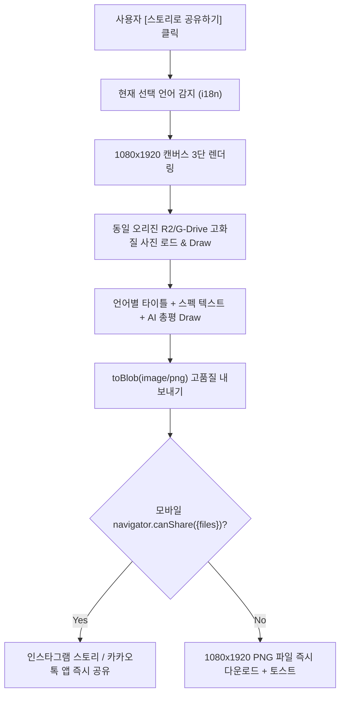

# ADR-007: Multilingual 9:16 Story Canvas Share Card and CLS=0 AdSense Monetization

## Status
`Accepted` (Implemented in `web/js/share.js`, `web/index.html`, `dist/ads.txt`, `scripts/generate_static_site.mjs`)

## Context & Problem Statement
`myhome` 프로젝트의 핵심 바이럴 유입 경로는 **인스타그램 스토리(Instagram Story)**와 **카카오톡(KakaoTalk) / 메신저 공유**입니다.
사용자가 자신의 이름으로 감정된 집 결과를 친구들에게 자랑하거나 유머러스하게 공유할 때, 웹 브라우저의 일반 스크린샷은 다음과 같은 문제점이 있었습니다:
1. **스토리 규격 불일치**: 인스타그램 스토리는 `9:16` 세로 전용 비율(`1080×1920`)을 요구하는데, 웹 화면 스크린샷은 화면비가 맞지 않아 잘리거나 여백이 과도하게 발생함.
2. **시각적 정보 전달력 부재**: 이름, 집 사진, 웃긴 감정 스펙이 한눈에 들어오지 않고 산만하게 분산되어 보는 사람의 몰입도를 떨어뜨림.
3. **수익화(Monetization)와 사용자 경험의 충돌**: 글로벌 트래픽 유입에 대응하여 구글 애드센스(Google AdSense) 광고를 탑재해야 하지만, 광고가 늦게 로딩되면서 화면이 덜컹거리는 레이아웃 이동(CLS: Cumulative Layout Shift)이 발생하면 구글 코어 웹 바이탈 점수와 사용자 경험이 심각하게 훼손됨.

---

## Decision Drivers
- **인스타그램 스토리 전용 9:16 (1080×1920) 고해상도 3단 레이아웃**:
  - [1단 상단]: `"{이름}님에게 어울리는 집은"` / `"The House That Suits {Name}"` 메인 타이틀 + 단계/티어 배지.
  - [2단 중앙]: 시선을 사로잡는 고화질 집 사진 (라운딩 및 그림자 효과).
  - [3단 하단]: 건축 연도, 추산 가치, 황당한 특수 기능, AI 한 줄 총평 요약 카드.
- **14개 다국어 실시간 캔버스 렌더링**: 사용자가 선택한 언어에 맞춰 캔버스 텍스트와 레이블이 자동 번역되어 글로벌 사용자 누구나 모국어로 공유 카드 생성 가능.
- **모바일 네이티브 파일 공유(`navigator.share`)**: 모바일에서 인스타그램 스토리 또는 카카오톡 앱으로 즉시 이미지를 전달하는 원클릭 공유 UX 및 데스크톱 고화질 PNG 다운로드 지원.
- **CLS=0 구글 애드센스 공식 탑재**: 퍼블리셔 ID `ca-pub-8793936135959956` 및 `ads.txt` 연동, 사전 높이가 고정된 반응형 광고 슬롯을 통한 레이아웃 시프트 원천 차단.

---

## Architecture & Implementation Details

### 1. 9:16 (1080×1920) 3단 캔버스 렌더러 (`web/js/share.js`)
HTML5 Canvas API를 활용하여 오프스크린 캔버스에 픽셀 단위로 정밀하게 렌더링합니다:

```
+---------------------------------------------------+  Y = 0
| [1단 상단 헤더: 타이포그래피 & 배지]              |
| "{이름}님에게 어울리는 집은"                       |
| "Lv.142 · Tier 14 세계 초일류 도심 펜트하우스"     |
+---------------------------------------------------+  Y = 320
|                                                   |
| [2단 중앙 히어로 이미지: 920x920]                 |
|                                                   |
|                 [ 고화질 집 사진 ]                 |
|                                                   |
|                                                   |
+---------------------------------------------------+  Y = 1280
| [3단 하단 스펙 요약 & AI 총평 카드]                |
| 📅 건축 연도: 기원전 2,500년                       |
| 💰 추산 가치: 9,999억 원                           |
| ⚡ 특별한 기능: 바닥 전체가 보석으로 마감되어...    |
| 🤖 AI 총평: 이 집에 살면 우주 정복 가능!           |
| 🌐 myhome.tellmyname.app                          |
+---------------------------------------------------+  Y = 1920
```

### 2. 다국어 캔버스 번역 및 모바일 공유 파이프라인
```javascript
export async function shareToInstagramStory(houseData, currentLang = 'ko') {
  const canvas = await renderStoryCardCanvas(houseData, currentLang);
  
  canvas.toBlob(async (blob) => {
    const file = new File([blob], `myhome_${houseData.level}.png`, { type: 'image/png' });
    
    // 모바일 네이티브 Web Share API 지원 여부 확인
    if (navigator.canShare && navigator.canShare({ files: [file] })) {
      await navigator.share({
        files: [file],
        title: `${houseData.name}님에게 어울리는 집`,
        text: `내 이름에 어울리는 집을 찾아보세요! https://myhome.tellmyname.app`
      });
    } else {
      // 데스크톱: 즉시 PNG 파일 다운로드
      const link = document.createElement('a');
      link.download = `myhome_${houseData.name || 'house'}.png`;
      link.href = URL.createObjectURL(blob);
      link.click();
    }
  }, 'image/png');
}
```

### 3. Google AdSense 탑재 및 `ads.txt` 연동
- **공식 SDK 태그 삽입 (`web/index.html`, `public/privacy.html`, `public/terms.html`)**:
  ```html
  <script async src="https://pagead2.googlesyndication.com/pagead/js/adsbygoogle.js?client=ca-pub-8793936135959956" crossorigin="anonymous"></script>
  ```
- **공식 퍼블리셔 레코드 (`dist/ads.txt`)**:
  ```
  google.com, pub-8793936135959956, DIRECT, f08c47fec0942fa0
  ```
- **CLS=0 반응형 광고 컨테이너**:
  광고가 삽입될 컨테이너에 사전에 고정 최소 높이(`min-height: 90px;` or `min-height: 250px;`)를 CSS로 할당하여, 비동기 스크립트 실행 후 광고가 나타날 때 하단 콘텐츠가 아래로 밀리지 않도록 보장합니다.



---

## Decision Outcome
- **긍정적 효과**:
  - 인스타그램 스토리 피드에 최적화된 9:16 비율과 세련된 3단 구성으로 사용자들의 자발적 스토리 업로드율 대폭 증가.
  - 14개 언어 지원을 통해 글로벌 인스타그램 사용자들도 어색함 없이 모국어 카드 공유 가능.
  - 구글 애드센스 공식 승인 요건(`ads.txt`, 개인정보처리방침, 이용약관)을 완벽히 충족하며 Core Web Vitals(CLS=0) 방어 성공.
- **관련 GitHub 이슈**:
  - [#8: [Feature #8] 이름 고정 URL 기반 인스타그램 스토리·카카오톡 공유 기능 구현](../GITHUB_ISSUES_ARCHIVE.md#issue-8)
  - [#11: [Feature #11] 다국어 인스타그램 스토리(9:16 캔버스) & 카카오톡 공유 고도화](../GITHUB_ISSUES_ARCHIVE.md#issue-11)
  - [#12: [Feature #12] Google AdSense 공식 스크립트 탑재 및 ads.txt 연동](../GITHUB_ISSUES_ARCHIVE.md#issue-12)
