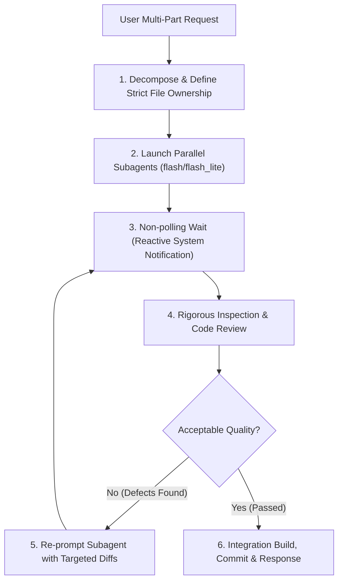

# Use Multi-Agent Orchestration Skill

When a user requests multiple independent or modular features, the main agent orchestrates work across specialized subagents using a deterministic cycle: **Decompose → Contract & Assign → Wait & Collect → Inspect & Review → Re-prompt or Finalize**.

---

## 1. Task Decomposition & File Ownership Rules
1. **Zero-Overlap Boundary**: Every subagent MUST be assigned an exclusive set of files or directories. Two subagents must NEVER edit the same file simultaneously.
2. **Shared Contract First**: If subagents need to communicate, create the interface, event bus, or data schema (e.g., `core.js` or `schema.prisma`) in the parent turn BEFORE delegating.
3. **Model Selection**:
   - Default heavy coding or routine component tasks to lightweight, cost-effective models (`flash` or `flash_lite`).
   - Reserve parent model capacity for architectural coordination and code inspection.

---

## 2. Invocation Guidelines
When calling `invoke_subagent`:
- **Role**: Specific 2~5 word title (e.g., `"Search Bar Developer"`, `"Cloudflare Hosting Engineer"`).
- **Prompt**:
  - Explicit list of owned files (`web/js/search.js`, `web/css/search.css`).
  - Strict prohibition: "Do NOT edit `core.js` or `index.html`".
  - Concrete inputs, expected UI/UX behaviors, and edge cases.
  - Requirement to run syntax check (e.g. `node --check`) before reporting.

---

## 3. Review & Inspection Protocol (Critical)
Never trust subagent completion reports blindly without inspection:
1. **Git Diff Inspection**:
   Run `git status -s` or `git diff <file>` to verify actual modifications match assigned scope.
2. **Automated Tool Inspection**:
   - Syntax validation: `node --check <file>`, `python -m py_compile <file>`.
   - AI-Powered Diff Review: Use `ocr.cmd delegate preview` or Alibaba Open Code Review (`ocr.cmd`) if configured.
3. **Integration Verification**:
   - Execute the centralized build script (e.g. `node scripts/generate_static_site.mjs`).
   - Run end-to-end smoke checks or fetch tests against the dev server.

---

## 4. Re-assignment & Iteration Loop
If a subagent's code has flaws:
1. Send targeted feedback via `send_message` with the exact file path, offending line, and failure reason.
2. Do not rewrite from scratch if the structure is sound; guide the subagent to patch the diff.
3. Once all subagents have completed and their contributions pass review, perform the final git commit and present the outcome to the user.
